# Ford One — Expo

Ford One é um app companion para donos de veículos Ford: acompanha a saúde
do carro em tempo real, organiza manutenções e agendamentos, dá diagnóstico
assistido por IA a partir de foto/áudio, compara "manter ou trocar" o
veículo atual, e centraliza perfil, motoristas autorizados, notificações e
suporte — tudo num único hub. É a versão Expo/React Native (TypeScript),
portada com fidelidade 1:1 do protótipo web (HTML/CSS/JS) do mesmo desafio,
rodando em iOS, Android e web a partir de uma única base de código.

Este README documenta o projeto como entregue: as seções abaixo (produto,
telas, stack, como rodar, build do APK e demonstração visual) descrevem o
estado final; o histórico de decisões de cada rodada de desenvolvimento
fica preservado mais abaixo, como changelog.

## Participantes
Gustavo Ikeda - 554718
Henrique Azevedo - 556707
Isadora Meneghetti - 556326
Khadija Lima - 558971
Ricardo Fernandes - 554597

## Funcionalidades por tela

**Início** — resumo do veículo ativo (placa, km, autonomia), saúde geral,
alertas ativos, próxima revisão e valor estimado, com troca rápida entre os
veículos da garagem.

**Meu Veículo** — hero com foto do modelo, ficha técnica completa, Ford Eco
Score com evolução em gráfico, garantia, localização, assistência 24h e
todos os sistemas do carro.

**Saúde** — gauge de saúde geral, diagrama interativo do carro (hotspots
por sistema), histórico de saúde e previsões "Ford One Intelligence" com
explicabilidade (por que o modelo chegou naquela previsão).

**Serviços** (hub) → **Manutenções** (próximas/recalls/concluídas com
previsão de próxima revisão), **Alertas** (lista com detalhe expansível),
**Agendamento** (serviço + concessionária + calendário de 5 dias com
horários reais + confirmação com validação), **Diagnóstico** (sintomas
selecionáveis ou foto/áudio do painel, análise simulada com confiança e
CTA de agendamento a partir do resultado).

**Ford One** — **Recomendações** (sugestões personalizadas), **Assistente**
(chat guiado), **Manter ou Trocar** (comparativo com Ford One Intelligence),
**Trocar meu Ford** (novos modelos com specs e simulação), **Ofertas**
(preço riscado/com desconto, agendamento pré-preenchido ou solicitação de
contato), **Concessionárias** (endereço, horário, avaliação, ligar/agendar).

**Conta** — **Perfil** (avatar, tema claro/escuro persistido, atalhos),
**Motoristas** (quem pode usar o carro e o que cada um pode fazer),
**Histórico** (linha do tempo de eventos do veículo), **Configurações**
(conta, senha, preferências, notificações, privacidade), **Suporte**
(busca de FAQ).

Ao todo, ~26 telas navegáveis, todas em tema claro e escuro, com um único
sistema de design (cores, tipografia, espaçamento e componentes
compartilhados — `Card`, `Badge`, `Toast`, `Icon` etc.) aplicado de ponta
a ponta.

## Stack técnica

- **Expo SDK 57** + **Expo Router v6** (navegação por arquivo, abas +
  telas empilhadas)
- **React 19** / **React Native 0.86** (New Architecture habilitada)
- **TypeScript** em 100% do código-fonte (`tsc --noEmit` limpo)
- **AsyncStorage** para persistência local (tema, configurações)
- **expo-image-picker** para a foto no Diagnóstico
- **react-native-svg** para os ícones customizados e o diagrama do veículo
- Roda em **iOS**, **Android** e **web** (`react-native-web`) a partir da
  mesma base de código

## Como rodar (desenvolvimento)

```
npm install
npx expo start
```

Aperte `w` para abrir no navegador, ou escaneie o QR code com o app Expo Go
no celular para ver no dispositivo real. `npm run typecheck` roda
`tsc --noEmit` no projeto inteiro.

## Gerando o APK final (Android)

O projeto está pronto para gerar um APK instalável de duas formas — escolha
a que fizer mais sentido para você:

### Opção 1 — EAS Build (recomendado, não precisa de Android Studio)

O [EAS Build](https://docs.expo.dev/build/introduction/) é o serviço de
build na nuvem da própria Expo. O projeto já vem com `eas.json` configurado
com um perfil `preview` que gera **APK** diretamente (o padrão do EAS para
Android gera `.aab`, formato de submissão à Play Store, não instalável
diretamente — por isso o perfil `preview` força `"buildType": "apk"`).

```
npm install -g eas-cli
eas login                                   # login com sua conta Expo (grátis)
eas build --platform android --profile preview
```

Ao terminar (o build roda nos servidores da Expo, leva alguns minutos), o
terminal mostra um link para baixar o `.apk` — ou baixe pelo painel em
https://expo.dev. Instale no celular (ative "Instalar apps desconhecidos"
se for a primeira vez) ou arraste para um emulador Android.

### Opção 2 — build local (precisa de Android Studio / SDK do Android)

```
npx expo prebuild --platform android   # gera a pasta android/ nativa
cd android
./gradlew assembleDebug                # gera um APK debug, instalável
# ou: ./gradlew assembleRelease        # release (precisa de keystore de assinatura)
```

O APK fica em `android/app/build/outputs/apk/debug/app-debug.apk` (ou
`release/app-release.apk`). `npx expo prebuild` é regenerável a qualquer
momento a partir do `app.json` — a pasta `android/` não é versionada.

### Identidade do app

`app.json` já define `android.package` (`com.fordone.app`),
`android.versionCode`, ícone adaptativo (fundo, primeiro plano e versão
monocromática) e splash screen — tudo o que o EAS Build e o
`expo prebuild` precisam, sem configuração adicional.

> **Nota de transparência:** este ambiente de desenvolvimento não tem
> acesso ao SDK do Android nem a `dl.google.com`/Maven Central (política de
> rede do sandbox), então o APK não pôde ser compilado *aqui* — mas o
> projeto foi validado com `npx expo prebuild --platform android`
> (gera a pasta nativa corretamente) e está 100% configurado para que a
> Opção 1 ou 2 acima funcione de primeira, sem nenhum ajuste extra.

## Demonstração visual

Capturas de tela de todas as ~26 telas (390×844, tema claro) ficam em
[`docs/screenshots/`](docs/screenshots/), organizadas por seção de
navegação:

**Início, Meu Veículo, Saúde**

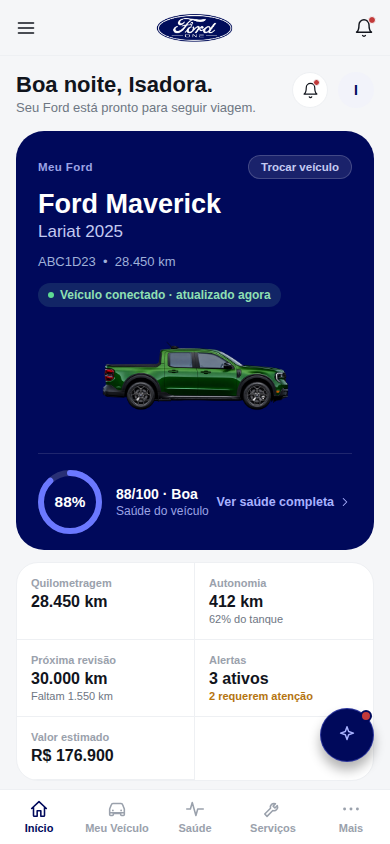
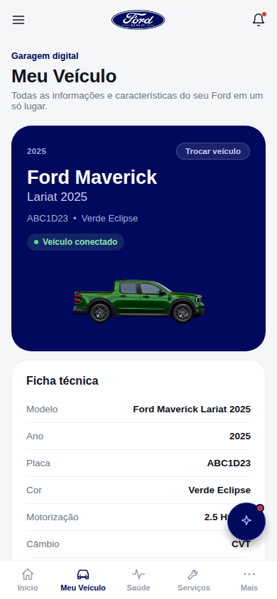


**Serviços: Manutenções, Alertas, Agendamento, Diagnóstico**


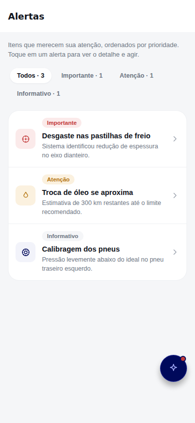
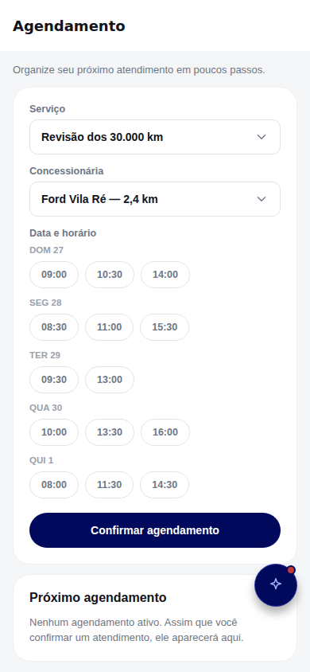


**Ford One: Recomendações, Assistente, Manter ou Trocar, Trocar meu Ford, Ofertas, Concessionárias**


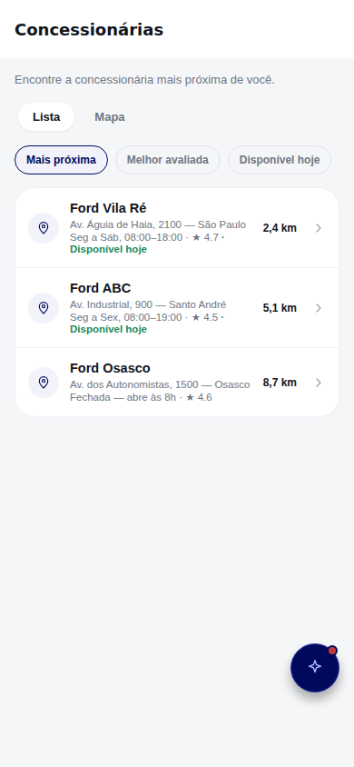

**Conta: Perfil, Motoristas, Histórico, Configurações, Suporte**


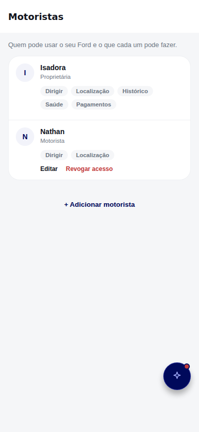
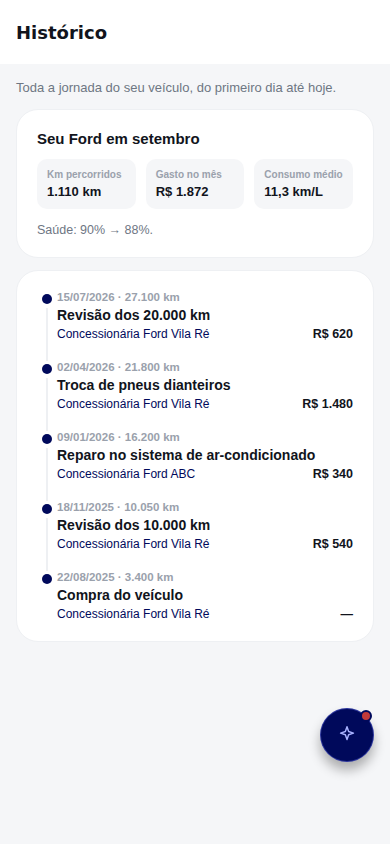

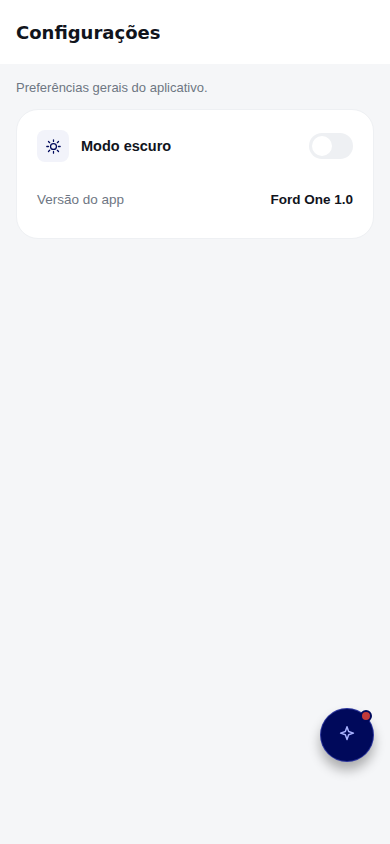

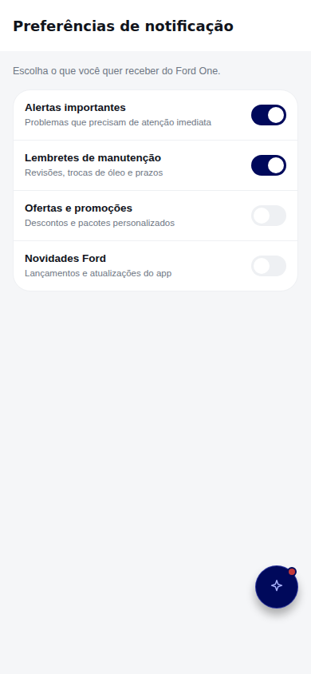
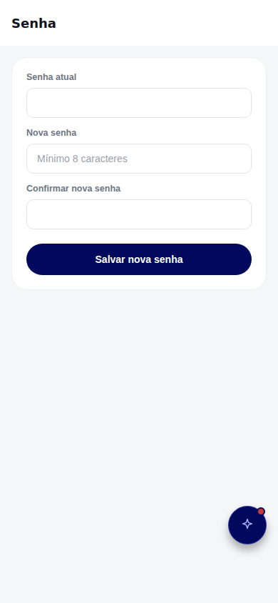
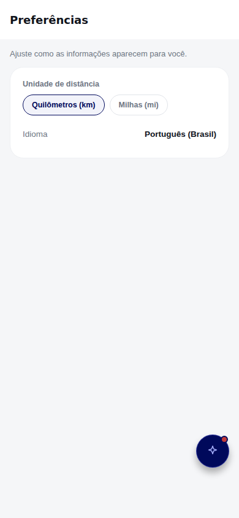
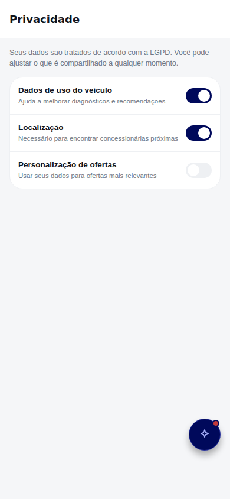


**Tema escuro** (mesmo sistema de design, alternável em Perfil)

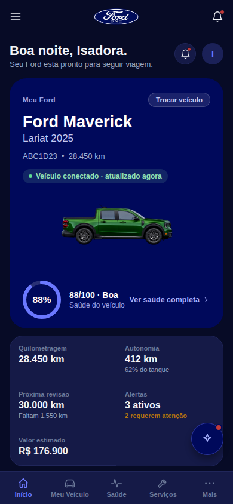
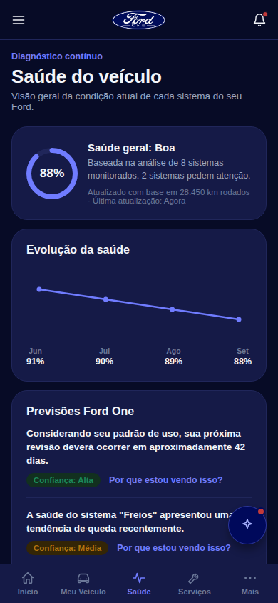


## Estrutura de pastas

A partir desta rodada, a estrutura segue o modelo pedido (`components/`,
`context/`, `hooks/`, `services/`, `styles/`, `utils/` etc.) na medida em
que o Expo Router permite — com desvios deliberados, explicados abaixo.

```
src/
  app/                   ← rotas (Expo Router). Ver nota "app/ dentro de src/" abaixo.
    (tabs)/                 telas das 5 abas (Início, Meu Veículo, Saúde, Serviços, Mais)
    *.tsx                   telas empilhadas (Manutenções, Alertas, Perfil, etc.)
    _layout.tsx              layout raiz (Stack, fontes, providers)
  components/            componentes de UI reutilizáveis (Card, Badge, Toast, ...) — .tsx
  context/               ThemeContext, AppStateContext (singular, como no modelo pedido) — .tsx
  styles/
    theme.ts                cores, raios, espaçamento, fontes — 1:1 com style.css
  constants/
    nav.ts                  páginas/grupos/abas de navegação — 1:1 com PAGES do script.js
    healthHotspots.ts, vehiclePhotos.ts — outras constantes específicas do domínio
    data/                   dados do app, organizados por domínio (ver abaixo) — .ts
  types/
    index.ts                tipos de domínio compartilhados (Vehicle, VehicleHealth,
                             VehicleAlert, MaintenanceData, Dealership, Appointment, ...)
                             usados por vários arquivos de `constants/data/`, `context/`
                             e telas — ver seção "Migração para TypeScript" abaixo.
assets/                  ← ícones/splash/imagens (permanece na raiz, ver nota abaixo)
```

Todo o projeto é TypeScript desde a rodada "Migração para TypeScript" (ver
seção correspondente abaixo): arquivos com JSX são `.tsx`, arquivos de
dados/lógica pura sem JSX são `.ts`. Referências antigas a `.js`/`.jsx`
neste README (de rodadas anteriores, mantidas como estão por serem
histórico) descrevem o estado do projeto *naquela* rodada — a estrutura de
pastas e a organização por domínio continuam as mesmas, só a extensão dos
arquivos mudou.

### `app/` dentro de `src/`

O Expo Router v57 suporta oficialmente mover `app/` para `src/app/`
(https://docs.expo.dev/router/reference/src-directory/): é só mover a pasta
e reiniciar o `expo start` — ele detecta `src/app` automaticamente (loga
"Using src/app as the root directory for Expo Router."), e "se `app/` e
`src/app/` existirem os dois, `src/app/` tem prioridade". Como o projeto
não usa `tsconfig.json`/alias `@/*` (é JS puro, importa tudo por caminho
relativo), a migração foi só mover a pasta e ajustar os `import` relativos
de `../../src/...`/`../src/...` para `../../...`/`../...` (removendo o
segmento `src/`, já que as telas agora estão *dentro* de `src/`). Arquivos
de config (`app.json`, `package.json`, `metro.config` implícito) continuam
na raiz, como a doc pede. Isso deixa `src/` mais parecido com o modelo
pedido (um único diretório com tudo) sem quebrar o roteamento — que
continua sendo a única exigência inegociável do Expo Router.

### Onde o modelo do usuário não foi copiado ao pé da letra, e por quê

- **`app/` continua existindo (dentro de `src/`), não virou `pages/`** — é
  o nome que o Expo Router usa para detectar rotas por arquivo; renomear
  quebraria toda a navegação. O modelo enviado é de um projeto Create
  React App sem roteamento por arquivo, então não tem equivalente direto
  a essa pasta.
- **`context/` (singular)** — só renomeado de `contexts/` (plural) para
  bater com o nome do modelo; nenhuma mudança de conteúdo.
- **`styles/`** — `constants/theme.js` (cores, raios, espaçamento,
  família de fontes) foi movido para `src/styles/theme.js`, que é
  exatamente o que o modelo chama de "Estilos globais".
- **Sem `hooks/` dedicado** — os únicos "hooks" do app (`useTheme`,
  `useAppState`, `useToast`) são wrappers finos de `useContext` colados
  de propósito ao Provider/Context que eles leem (`ThemeContext`,
  `AppStateContext`, `Toast.js`). Isso é o padrão idiomático de Context
  API em React: separar o hook do seu Provider só para preencher uma
  pasta `hooks/` adicionaria um import extra sem nenhum ganho real, então
  a decisão foi não forçar essa pasta.
- **Sem `services/`** — o app não fala com nenhum backend real (dado
  simulado localmente, por regra do projeto), então não existe camada de
  serviço/API para organizar. Criar uma pasta `services/` vazia (ou com
  um "serviço" fake) só para bater com o modelo seria pior do que não
  ter a pasta.
- **`components/` continua "achatado"** (um `ComponentName.js` por
  componente, sem subpasta `ComponentName/ComponentName.js` +
  `.test.js` + `.css`) — o projeto não tem arquivos de teste nem estilo
  separados por componente (estilos ficam em `StyleSheet.create()` no
  próprio `.js`, testes ainda não existem), então a subpasta do modelo
  viraria uma pasta com um único arquivo dentro — cerimônia sem função.
  Decisão deliberada, não descuido.
- **Sem `utils/` novo** — auditei o código atrás de helpers genéricos
  espalhados fora do lugar. O que existe (`daysUntil()`,
  `getWarrantyRemaining()`, `getMonthsSincePurchase()`) é lógica de
  domínio (datas de manutenção/garantia/compra), não utilitário genérico,
  e já mora junto do dado que ela calcula — mover só por mover arriscaria
  quebrar imports sem ganho de clareza. As chamadas `.toLocaleString('pt-BR')`
  espalhadas são one-liners triviais, não helpers a extrair.
- **`constants/data/` continua como está** — é a organização específica
  deste port (tela/domínio ⇄ arquivo de dados), sem equivalente direto no
  modelo (que não tem apps com tanta "massa de dados mock"). Considerei
  agrupar em `features/<nome>/` (dado + lógica juntos), mas isso exigiria
  reescrever a barrel `index.js` e todos os imports por `.../constants/data`
  sem nenhum ganho real — a separação atual (rotas em `app/`, dados
  compartilhados em `constants/data/`) já é uma organização coerente.
- **`assets/` continua na raiz**, não em `src/assets/` — o `app.json`
  (que por regra do Expo tem que ficar na raiz) referencia os ícones por
  caminho relativo à raiz (`./assets/icon.png` etc.), e mover as imagens
  para dentro de `src/` exigiria reescrever essas referências sem
  nenhum benefício — é convenção padrão do Expo manter `assets/` na raiz.

`src/constants/data/` — cada tela/domínio tem seu próprio arquivo, em vez de
um `data.js` único de 670+ linhas:

- `state.js` — veículo, saúde, alertas e manutenção **ativos**, mais a
  garagem com os 3 veículos e `loadVehicleBundleData()`. Fica junto porque
  são bindings `let` reatribuídos ao trocar de veículo — só o módulo que
  declara `export let x` pode reatribuir `x` em JavaScript, então essa
  lógica não dá para separar do dado sem quebrar.
- `user.js`, `home.js`, `vehicleScreen.js`, `healthScreen.js`, `services.js`,
  `scheduling.js`, `diagnosis.js`, `profile.js`, `dealerships.js`,
  `offers.js`, `history.js`, `keepOrTrade.js`, `newFord.js`, `assistant.js`,
  `recommendations.js`, `notifications.js`, `support.js`, `settings.js` —
  um arquivo por domínio, cada um só com os dados/funções daquela tela.
- `index.js` — reexporta tudo, então as telas continuam importando de um
  só lugar (`from '.../constants/data'`), só que agora os dados em si vivem
  organizados por assunto em vez de um arquivo gigante.

Import paths: dentro de `src/`, os arquivos se importam entre si normalmente
(estão todos no mesmo nível). As telas em `src/app/` importam do resto de
`src/` com `../...` (telas de primeiro nível) ou `../../...` (telas dentro
de `(tabs)/`) — sem o segmento `src/`, já que `app/` agora está dentro de
`src/`.

## O que já está pronto e testado

- Projeto Expo configurado (Router, tema claro/escuro persistido, ícones)
- Navegação por abas: Início, Meu Veículo, Saúde, Serviços
- Telas **Início**, **Meu Veículo** e **Saúde** portadas por completo: hero
  do veículo, gauge de saúde, status rápido, ficha técnica, garantia,
  localização, assistência 24h, Eco Score, evolução em gráfico, previsões
  Ford One (com explicabilidade), Digital Twin, todos os sistemas
- **Serviços** como hub, com navegação real para **Manutenções**
  (próximas/concluídas), **Alertas** (com detalhe expansível),
  **Agendamento** (seleção de serviço/concessionária, calendário de 5 dias
  com horários reais, confirmação com validação e toast), **Diagnóstico**
  (sintomas selecionáveis, análise simulada com resultado e confiança,
  botão de agendar a partir do resultado), **Perfil** (avatar, alternância
  de tema, grupos de configuração, sair da conta), **Concessionárias**
  (3 concessionárias com avaliação, endereço, horário, telefone, ligar e
  agendar direto ali), **Ofertas** (3 ofertas com preço riscado/com
  desconto, cada uma leva pro Agendamento pré-preenchido ou dispara uma
  solicitação de contato), **Histórico** (linha do tempo com 5 eventos,
  desde a compra do veículo até a revisão mais recente) e
  **Manter ou Trocar** (recomendação com base na saúde real do veículo,
  composição do custo mensal por categoria, saúde geral) — telas
  empilhadas (fora das abas), com botão de voltar
- Sistema de tema (`constants/theme.js`) com as mesmas cores do app web,
  em modo claro e escuro, com alternância e persistência (AsyncStorage)
- Modelo de dados inicial (`constants/data.js`) com veículo, saúde e alertas

## O que ainda falta

**Todos os 11 itens do hub Serviços estão portados e funcionais.**
`newFord.js` (Trocar meu Ford) fecha a lista: 3 veículos da linha atual
Ford, seleção com destaque visual, simulador de financiamento reativo
(entrada usando o valor de troca do seu Ford + entrada adicional escolhida
+ prazo, com a parcela recalculada a cada mudança) e agendamento de
test-drive — que usa o mesmo `AppStateContext` para pré-selecionar
"Test-drive" no Agendamento. O CTA "Ver opções de troca" em Manter ou
Trocar agora navega direto para essa tela, sem toast de aviso. Dentro de **Perfil**, os itens de configuração
(Minha conta, Senha, Notificações, Preferências, Privacidade, Suporte)
também mostram esse toast — só o alternador de tema e "Sair da conta"
são funcionais de verdade. — o app web já tem tudo isso
implementado em `script.js`, mas cada um é uma tela própria a portar.

## Componentes compartilhados (novos nesta rodada)

- `components/Row.js` — linha label/valor (ficha técnica, garantia)
- `components/Chip.js` — chip selecionável (Assistência 24h)
- `components/Toast.js` — feedback de ação, funciona em web/iOS/Android
  (o `Alert.alert()` do React Native não funciona na web, então usamos
  isso no lugar em qualquer ação que precise de confirmação visual)
- `components/LineChart.js` — gráfico de linha em SVG (evolução da saúde)
- `components/Picker.js` — seletor "toque para abrir" (não existe `<select>`
  nativo consistente entre plataformas em React Native)

## Navegação empilhada (fora das abas)

`app/maintenance.js` e `app/alerts.js` são exemplos de telas acessadas
por navegação empilhada (`router.push`), com cabeçalho e botão de voltar
nativos — o padrão a seguir para as próximas telas de `services.js`
(Diagnóstico, Concessionárias, etc.), em vez de virarem abas.

**Resolvido**: `contexts/AppStateContext.js` guarda o agendamento
confirmado e o serviço sugerido por outra tela, e é usado por três telas
diferentes:
- `diagnosis.js` grava o serviço sugerido no resultado da análise
- `scheduling.js` lê esse serviço sugerido para pré-selecionar o campo
  "Serviço" (e o limpa depois de usar, pra não sobrescrever uma escolha
  manual futura), e grava o agendamento confirmado
- `(tabs)/index.js` (Home) lê o agendamento confirmado e mostra um card
  "Próximo agendamento" — testado o fluxo completo: Diagnóstico sugere
  um serviço → Agendamento vem pré-preenchido → confirma → aparece na Home
- `dealerships.js` também grava um `suggestedDealer` — "Agendar aqui" em
  qualquer concessionária pré-seleciona ela no Agendamento (testado)

Nota 2: as abas Foto e Áudio do Diagnóstico simulam o resultado (mesmo
espírito da versão web), mas não capturam foto/áudio de verdade — isso
exigiria integrar `expo-camera`/`expo-av`, ainda não incluído.

Nota: o diagrama interativo do carro com os pontos de inspeção (que existe
na versão web) ainda não foi portado — a tela de Saúde aqui usa a lista
"Todos os sistemas" (com toque para expandir e ver a tendência) no lugar.

## Como rodar

```
npm install
npx expo start
```

Aperte `w` para abrir no navegador, ou escaneie o QR code com o app
Expo Go no celular para ver no dispositivo real.

Desde a migração para TypeScript, `npm run typecheck` roda `tsc --noEmit`
para conferir o projeto inteiro sem gerar arquivos — útil para rodar antes
de commitar, já que o Metro/Babel não bloqueiam o `expo start`/`expo
export` em erros de tipo (eles só transpilam, não checam tipos).

## Rodada seguinte: Assistente e Recomendações

Adicionadas duas telas que não faziam parte do hub original de 11 itens,
mas existem na versão web:

- **`assistant.js`** — chat de verdade com a Ford One Intelligence: mensagens
  do usuário e da IA em bolhas, scroll automático, chips de sugestão que
  somem após a primeira pergunta, teclado tratado com `KeyboardAvoidingView`.
  As respostas vêm de `getAssistantResponse()` em `constants/data.js`, um
  motor de palavras-chave (freio, óleo, revisão, saúde, trocar, km) que
  responde com dados reais do veículo — testado com pergunta por chip e
  pergunta digitada livremente.
- **`recommendations.js`** — 3 recomendações com ícone, texto e selo de
  confiança, no mesmo padrão visual das outras telas de cartão.

Ambas acessíveis pelo hub Serviços, grupo "Assistência".

## Rodada seguinte: Notificações e Suporte

Duas telas do grupo "Conta" em Perfil, que antes eram só toast:

- **`notifications.js`** — 4 notificações, não lidas em negrito com bolinha
  azul, toque marca como lida (testado: some a bolinha, texto fica normal).
- **`support.js`** — 4 perguntas frequentes em acordeão (toque expande/
  recolhe a resposta).

Ainda como toast em Perfil: Minha conta, Senha, Preferências, Privacidade.

## Rodada seguinte: o resto do Perfil

- **`account.js`** (Minha conta) — nome, e-mail, telefone editáveis, salvar
  com toast de confirmação.
- **`password.js`** (Senha) — mesma validação de três camadas do site:
  campos vazios → "Preencha todos os campos"; menos de 8 caracteres →
  aviso específico; senhas diferentes → outro aviso. Testado o primeiro
  caso.
- **`preferences.js`** — 4 alternadores independentes (notificações push,
  e-mails promocionais, localização, dados de uso), cada um com sua
  descrição. Testado ligar um sem afetar os outros.
- **`privacy.js`** — 2 alternadores de privacidade com nota sobre LGPD.
- Novo componente `components/Switch.js`, reaproveitado nas duas últimas.

**Com isso, todos os itens de Perfil estão portados.** O que resta de
verdade da lista original é: múltiplos veículos na garagem, e o diagrama
interativo do carro na Saúde.

## Rodada seguinte: Garagem (múltiplos veículos) — funcional

Implementada a garagem com os 3 veículos (Maverick, Ranger, Mustang Mach-E),
igual à versão web:

- `constants/data.js`: `vehicle`, `vehicleHealth`, `alerts` e `maintenance`
  viraram bindings `let` (em vez de `const`), porque trocar de veículo
  precisa reatribuí-los por inteiro. Um novo array `garage` guarda os 3
  pacotes completos (veículo + saúde + alertas + manutenção — dados reais
  e distintos por veículo, não só o nome mudando: km, saúde geral,
  sistemas, alertas e manutenções pendentes são todos coerentes entre si
  por veículo). `loadVehicleBundleData(index)` troca os quatro bindings
  para o pacote escolhido. `specFields` e `digitalTwinItems` viraram
  funções (`getSpecFields()`, `getDigitalTwinItems()`) porque antes eram
  calculados uma vez na carga do módulo e ficavam "congelados" com os
  dados do primeiro veículo.
- `contexts/AppStateContext.js`: novo `activeVehicleIndex`, `switchVehicle(i)`
  e um contador `vehicleVersion` — como os bindings do passo acima não são
  reativos sozinhos, as telas que mostram dados do veículo ativo assinam
  `vehicleVersion` via `useAppState()` para re-renderizar quando ele muda.
- `(tabs)/vehicle.js`: novo card "Minha garagem" com os 3 veículos lado a
  lado (nome, versão, destaque visual e selo "Ativo" no atual); tocar em
  outro dispara `switchVehicle` + toast de confirmação.
- `(tabs)/index.js`, `(tabs)/health.js`, `alerts.js`, `maintenance.js`,
  `keepOrTrade.js` — todos assinam `vehicleVersion` e voltaram a mostrar
  dados corretos após a troca.
- `alerts.js` ganhou um estado vazio ("Tudo certo por aqui" / "Nenhum
  alerta ativo para este veículo no momento.") para o Mach-E, que não tem
  nenhum alerta ativo.
- O card de alertas da Home também parou de mostrar "3 ativos" fixo — agora
  usa a contagem real (`alerts.length`), incluindo o caso "Nenhum".

Testado via export + Puppeteer: trocar para o Ranger atualiza corretamente
Meu Veículo (hero, ficha técnica, destaque na garagem), Início (hero,
status rápido, barras de saúde) e Saúde (gauge, gráfico de evolução,
previsões, Digital Twin — todos os 87%). Trocar para o Mach-E atualiza os
mesmos pontos (95%, elétrico) e confirma o estado vazio de Alertas, a
manutenção única pendente e a recomendação "manter" com os custos do
Mach-E em Manter ou Trocar. Zero erros de console em todos os passos.

## Rodada seguinte: fidelidade visual com o HTML + reorganização de pastas

Dois ajustes pedidos depois de revisar o app:

**Fidelidade com o `style.css` do MVP final do HTML** — sem mudar nada de
propósito, só corrigindo onde os valores portados tinham ficado
imprecisos:

- `src/constants/theme.js`: cores reconferidas contra `:root` e
  `[data-theme="dark"]` do `style.css`, valor por valor. Alguns estavam
  arredondados/errados (ex.: `--gray-50` é `#F5F6F8`, não `#F5F6FA`;
  `--gray-500`/`--gray-400` — os textos secundário/terciário — estavam com
  tons diferentes do CSS). Também corrigido: `success`/`warning`/`danger`
  **não mudam** no modo escuro no CSS (só o fundo dos badges muda), então
  agora não mudam aqui também — antes o app usava tons mais claros nesses
  três no dark mode, o que não existe no HTML.
- Raios de borda (`--r-sm/md/lg/xl`) e o `Card` (raio + padding) agora usam
  os valores exatos do CSS (`.card{border-radius:var(--r-lg);padding:20px}`
  = 22px/20px — antes o `Card` usava 16px/16px).
- Fonte: o site carrega **Archivo** (Google Fonts) em `--font-ui`; o Expo
  não carregava fonte nenhuma (caía no padrão do sistema). Agora
  `app/_layout.js` injeta o mesmo `<link>` do Google Fonts na `<head>` (só
  no build web, via DOM API — não usa `app/+html.js` porque o projeto usa
  `web.output: "single"`, e a customização de `+html.js` só vale para
  `"static"`) e define `Archivo` como fonte padrão de todo `<Text>`, então
  os `fontWeight` que cada tela já define (400 a 900) resolvem pro peso
  real da fonte, igual no CSS — sem precisar mexer em cada tela.

**Reorganização de pastas** — ver seção "Organização de pastas" no topo
deste arquivo. `components/`, `contexts/` e `constants/` (incluindo o
`data.js` de 670+ linhas, agora dividido por domínio) foram movidos para
dentro de `src/`; `app/` continua na raiz porque o Expo Router exige.

Reconferido via export + Puppeteer depois da reorganização: navegação por
abas, navegação empilhada, troca de veículo na garagem e o estado vazio de
Alertas do Mach-E — tudo continua funcionando, zero erros de console.

## Rodada seguinte: barra superior, foto do veículo e troca rápida de garagem

Completa a fidelidade visual **estrutural** com o HTML apontada como
pendente na rodada anterior — mesmo escopo ("visual/design", não
funcionalidade/IA):

- **`src/components/TopBar.js`** (novo) — barra superior fixa igual à do
  site: ☰ à esquerda (abre um menu com os links das 4 abas + o toggle de
  modo escuro, reaproveitando o `BottomSheet`), logo do Ford One
  centralizado, sino de notificações à direita (com bolinha vermelha
  quando há alerta que precisa de atenção, ligando pra `/alerts`). Usada em
  **Início**, **Meu Veículo**, **Saúde** e **Serviços**.
- **`src/components/VehicleHeroArt.js`** (novo) — a foto real do veículo
  (PNG) dentro do hero, com fallback pra um ícone caso a imagem falhe.
  `src/constants/vehiclePhotos.js` mapeia `vehicle.photo` (`'maverick'` /
  `'ranger'` / `'mache'`) pro `require()` do PNG certo (o Metro exige
  `require()` estático, não dá pra montar o caminho dinamicamente).
  Assets copiados de `ford-one-web/assets/vehicles/`.
- **`src/components/GarageSwitcherSheet.js`** (novo, sobre `BottomSheet`) —
  o modal "Minha Garagem" do site: lista os 3 veículos com ícone, nome,
  versão e badge ("Ativo · X%" pro atual, "X%" com seta pros outros),
  toque troca o veículo ativo (mesma lógica de `switchVehicle()` de antes)
  e mostra um toast. Substituiu o card "Minha garagem" com 3 mini-cards que
  existia embaixo do hero (isso não existe no HTML — era só um placeholder
  de rodadas anteriores). Agora a troca de veículo acontece pelo botão
  "Trocar veículo" no hero, igual ao site.
- **Home** e **Meu Veículo**: hero reconstruído pra bater com o HTML —
  linha do topo com o ano/"Meu Ford" + pill "Trocar veículo", nome e versão
  do carro, foto do veículo, badge "Veículo conectado" e (só na Home) a
  barra de saúde com link "Ver saúde completa →". O cabeçalho da Home trocou
  o botão solto de tema pelo sino + avatar (inicial do nome), como no site.

Reconferido via export + Puppeteer: troca de veículo pelo modal (Maverick →
Ranger → Mach-E) atualizando Home e Meu Veículo com a foto e os dados
certos em cada tela, estado vazio de Alertas do Mach-E, modo escuro (menu,
Saúde, Serviços) — tudo certo, zero erros de console.

## Rodada seguinte: navegação idêntica ao HTML (5 abas + menu completo)

Fecha o item de estrutura de navegação apontado como pendente na rodada
anterior — agora replicado de propósito, não mais fora de escopo:

- **`src/constants/nav.js`** (novo) — mesma lista `PAGES`/`GROUP_ORDER`/
  `BOTTOM_IDS` do `script.js`, em um só lugar: id, label completo, grupo
  (Veículo/Assistência/Ford One/Conta), ícone e rota. `BOTTOM_IDS` são os 4
  itens do menu inferior (`home`, `vehicle`, `health`, `maintenance`);
  `MORE_PAGES` é o resto, na mesma ordem do `PAGES` original.
- **Menu inferior agora tem 5 abas**: Início, Meu Veículo, Saúde,
  **Serviços** (rótulo mobile do id `maintenance` — é a mesma tela de
  Manutenções, não um hub separado, igual no HTML) e **Mais**.
  `app/(tabs)/services.js` foi reescrito pra renderizar o conteúdo de
  Manutenções (agora em `src/components/MaintenanceBody.js`, compartilhado
  com a rota empilhada `app/maintenance.js` usada pelos links "Ver
  todas..."); o antigo card "hub" com grupos foi removido — não existe no
  HTML.
- **`app/(tabs)/more.js`** (novo) — grade de 3 colunas com os 11 itens que
  não estão no menu inferior (Histórico, Alertas, Agendamento, Diagnóstico,
  Recomendações, Assistente, Manter ou Trocar, Trocar meu Ford, Ofertas,
  Concessionárias, Perfil), mesmo conteúdo e ordem do `renderMoreSheet()`
  do site — como tela própria em vez de bottom sheet, já que o Expo Router
  Tabs exige uma tela por aba.
- **Menu do ☰ (TopBar) agora mostra a navegação completa**, agrupada por
  seção (igual à sidebar/drawer do site via `buildNavGroups()`), com
  scroll interno e o toggle de modo escuro fixo embaixo — antes só listava
  as 4 abas.

Reconferido via export + Puppeteer: aba Serviços abre Manutenções direto
(sem hub), aba Mais mostra a grade completa e navega corretamente (testado
com Perfil), o menu do ☰ mostra os 4 grupos com scroll, e a troca de
veículo + modo escuro continuam funcionando sem erro de console.

## Rodada seguinte: diagrama interativo do carro na Saúde

Fecha o último item da lista "O que ainda falta": o card "Inspeção do
veículo" que ficava faltando na tela de Saúde, entre Digital Twin e Todos
os sistemas — igual ao `health-diagram-stage`/`HEALTH_HOTSPOTS` do
`script.js`.

- **`src/constants/healthHotspots.js`** (novo) — mesmas posições (`x`/`y`
  em %) dos 8 pontos de inspeção do site, calibradas contra a foto real do
  veículo; ícone por sistema; e a lista de sistemas cobertos por garantia
  (motor/elétrico/freios/suspensão), igual ao `underWarranty` do
  `openSystemModal()`.
- **`src/components/VehicleHealthDiagram.js`** (novo) — a foto do veículo
  (reaproveitando `VehicleHeroArt`, que ganhou um modo `fill` pra ocupar o
  card inteiro em vez de um tamanho fixo) com um ponto tocável sobre cada
  sistema, na posição exata do site. Sistema com `status:"warn"` pulsa em
  laranja (`Animated` do RN, equivalente à animação `hotspotPulse` do
  CSS); os demais ficam com o ponto na cor do accent. Legenda embaixo
  ("Dentro do esperado" / "Pede atenção"), igual ao `health-legend`.
- **`src/components/SystemDetailSheet.js`** (novo) — o equivalente ao
  `openSystemModal()`: ícone + nome + badge de condição, nota, gauge com a
  pontuação + tendência e, quando o sistema pede atenção, o aviso de
  garantia (linkando pra Meu Veículo) e o botão "Agendar verificação"
  (linkando pro Agendamento) — mesmo conteúdo e mesmas condições do site.
  Aberto ao tocar em qualquer ponto do diagrama.
- `GaugeRing` ganhou um `ringColor` opcional (usado pra pintar o anel de
  laranja quando o sistema aberto no sheet está em atenção, igual ao
  gauge do modal no site).

Bug encontrado e corrigido durante o teste: `VehicleHeroArt`'s novo modo
`fill` inicialmente usava só `position:absolute` + `inset:0`
(`StyleSheet.absoluteFillObject`), mas isso não estica um elemento
substituído (``) na web quando `width`/`height` ficam "auto" — o
navegador cai pro tamanho intrínseco da imagem. A foto aparecia gigante
(tamanho real do PNG, 1040×392) vazando pra fora do card. Corrigido
somando `width:'100%', height:'100%'` explícitos ao estilo.

Reconferido via export + Puppeteer: os 8 pontos aparecem na posição
certa (com o `aria-label` de cada um batendo com sistema/score/condição),
tocar em "Freios" (sistema em atenção) abre o sheet certo com gauge
laranja, aviso de garantia e botão de agendamento; testado também com o
Mach-E (sem sistemas em atenção, todos os pontos na cor normal) e em modo
escuro — zero erros de console.

## Rodada seguinte: seções que faltavam em Início e Meu Veículo

Depois de fechar a lista de fidelidade visual/estrutural, fiz uma auditoria
tela a tela comparando cada `render<Nome>()` do `script.js` com a tela
correspondente no Expo, pra achar conteúdo que ainda estava faltando (não
só cor/layout — seções inteiras que existem no HTML e não tinham sido
portadas). Achei bastante coisa faltando em **Início** e **Meu Veículo**;
as duas foram completadas nesta rodada. A lista completa do que a
auditoria encontrou (incluindo o que ainda não foi feito) está na próxima
seção.

**Início** — 5 seções novas, todas entre "Seu Ford hoje" e o fim da
página, na mesma ordem do site:
- Link "Explorar todos os componentes" no fim do card "Seu Ford hoje", e
  "Ver análise completa" no card "Meu Ford Hoje" (faltavam os dois).
- **Card Ford One Intelligence** — previsão da troca de óleo, com
  confiança/fatores considerados e os botões "Ver análise" (expande os
  dados considerados, mesmo padrão do "Por que estou vendo isso?" da
  Saúde) e "Agendar manutenção".
- **Próximas ações** — as 3 linhas numeradas (troca de óleo, revisão,
  verificação dos pneus) com toque levando pro agendamento ou abrindo o
  sistema correspondente.
- **Seu Ford precisa da sua atenção** — os 2 alertas mais importantes,
  com os botões de ação reais ("Ver saúde dos freios", "Agendar troca de
  óleo" etc.) — os dados de `alerts` ganharam os campos `system`/`actions`
  que faltavam pra isso funcionar.
- **Atividade recente** — as 3 últimas entradas do histórico, em timeline.
- **Acessos rápidos** — grade com Agendar serviço / Diagnosticar problema
  / Encontrar concessionária / Manter ou trocar.
- Novo componente compartilhado: `SystemDetailSheet` (usado no Health
  desde a rodada passada) agora também abre a partir do Início — tocar em
  qualquer sistema do card "Seu Ford hoje" ou numa ação de alerta abre o
  mesmo sheet de detalhe.

**Meu Veículo** — 3 seções novas, entre a ficha técnica/quick-stats e a
Garantia Ford:
- **Software do veículo** — versão atual, última atualização e, quando há
  atualização disponível, "Ver novidades" (abre as notas da versão num
  sheet) e "Agendar atualização". Simplificado em relação ao site: sem a
  simulação de instalação com progresso ao vivo (`softwareState`
  isInstalling), só o essencial informativo + os dois CTAs.
- **Minhas viagens** — as 4 viagens recentes, cada uma com seu Eco Score;
  tocar abre um sheet com distância, duração, velocidade média, consumo e
  Eco Score da viagem.
- **Documentos** — CRLV, manual, apólice, nota fiscal, comprovantes, com
  badge "Vence em breve" calculado pela mesma lógica de dias restantes do
  site.

Reconferido via export + Puppeteer: as 5 seções novas do Início (incluindo
o card oculto quando não há alertas, testado com o Mach-E), o sheet de
sistema abrindo a partir de um alerta, e as 3 seções novas do Meu Veículo
com os sheets de novidades e detalhe de viagem — zero erros de console.

## O que a auditoria encontrou (backlog)

Uma comparação tela a tela com o `script.js` mostrou mais itens além dos
que foram fechados acima. Nenhum é um problema de cor/fonte — são seções
ou fluxos inteiros do site que ainda não existem no Expo. Deixo
registrado aqui pra não perder de vista, em ordem de tamanho do que falta:

- **Manter ou Trocar**: TCO (custo total de propriedade em 12 meses),
  índice de troca, previsão de revenda, comparação Manter vs Trocar em 24
  meses, "Avaliar meu veículo" e "Simular financiamento" (calculadora
  interativa) — hoje a tela só tem o essencial.
- **Alertas**: faltam as abas de filtro (Todos/Importante/Atenção/
  Informativo) e os botões de ação nas linhas expandidas (hoje só mostra
  o texto da recomendação).
- **Agendamento**: falta o acompanhamento "Seu Ford está na
  concessionária" (etapas, aprovação de orçamento, forma de pagamento).
- **Concessionárias**: falta alternância Lista/Mapa e os chips de filtro
  (Mais próxima / Melhor avaliada / Disponível hoje).
- **Trocar meu Ford**: falta o comparador de veículos (checkboxes +
  tabela lado a lado) e o favoritar (coração).
- **Recomendações**: os cards mostram só o texto — falta o botão de ação
  de cada recomendação.
- **Histórico**: falta o card-resumo do mês (km rodados, gasto, consumo
  médio, evolução da saúde).
- **Assistente**: as respostas da IA no site podem trazer botões de ação
  inline (ex. "Agendar troca de óleo"); no Expo só tem os chips de
  sugestão fixos.

Isso é bastante trabalho por seção — faço uma de cada vez, na ordem que
fizer mais sentido pra você (ou me diga qual delas é a mais importante
para focar primeiro).

## Rodada seguinte: os 8 itens do backlog, todos fechados

Pedido do usuário: "todos". Os 8 itens listados acima foram implementados,
um a um, contra o `script.js` do HTML linha a linha. Fonte de dados nova
compartilhada: `src/constants/data/costs.js` (`getCostBreakdown`,
`getTcoAndForecast`, `getResaleProjection`, `getTradeInEstimate`,
`sumHistoryCosts`, `getMonthsSincePurchase` — a mesma aritmética do
`getCostBreakdown()`/`getTcoAndForecast()` do site, usada tanto por
Histórico quanto por Manter ou Trocar). Também adicionado `consumption`/
`consumptionKmL` por veículo em `state.js` (faltava — sem isso o custo de
combustível do TCO não tinha como ser calculado por veículo).

- **Recomendações** — cada card agora tem o botão de CTA (`r.cta`) ligado
  a `r.action` (`schedule` pré-seleciona o serviço e abre Agendamento,
  `system` abre o `SystemDetailSheet` do sistema, `page` navega). Dados de
  `recommendations.js` reconferidos contra o `const recommendations` do
  site (título, desc, cta e action exatos — o card tinha um selo de
  "confiança" e um texto que não existem no HTML; removidos).
- **Histórico** — novo card "Seu Ford em [mês]" antes da timeline: km
  percorridos, gasto no mês, consumo médio e "Saúde: X% → Y%", usando
  `getMonthlyRecap()` (mesma fonte de dados do card de custos de Manter ou
  Trocar, não um resumo inventado à parte).
- **Assistente** — `getAssistantReply()` substitui `getAssistantResponse()`
  antigo: motor de regras por palavra-chave igual ao `findAssistantAnswer()`
  do site (freio/óleo/pneu/revisão/saúde/trocar/km/agendar/concessionária/
  alerta/garantia/valor/gasto), cada resposta podendo trazer botões de ação
  inline (`kind: page/system/schedule`) além dos chips de sugestão fixos
  que já existiam.
- **Alertas** — abas de filtro (Todos/Importante/Atenção/Informativo) com
  contagem ao vivo, "Dispensar" por alerta (estado local, um `Set` de ids
  dispensados — não precisa ser global porque só afeta esta tela, igual ao
  `alertsUiState.dismissed` do site) e "Restaurar N alertas dispensados"
  quando há algum dispensado. Os botões de ação da linha expandida
  (`a.actions`) já existiam nos dados desde uma rodada anterior — agora
  estão realmente ligados (`system` abre o sheet do sistema, `schedule`
  pré-seleciona o serviço e abre Agendamento).
- **Agendamento** — "Cancelar agendamento" e "Simular chegada na
  concessionária" no card do próximo agendamento; ao fazer check-in,
  aparece o card "Seu Ford está na concessionária" com o tracker de 5
  etapas (Recebido/Diagnóstico/Serviço/Lavagem/Pronto, com hora de cada
  uma), orçamento digital (aprovar/recusar/falar com consultor) na etapa
  "Serviço", chips de forma de pagamento na etapa "Pronto" e "Avançar
  etapa (simular)"/"Concluir atendimento" — mesmo fluxo e valores
  (R$ 320 + R$ 90 mão de obra) do `renderServiceProgressCard()` do site.
  O modal de detalhe do agendamento confirmado (com "Adicionar ao
  calendário" via `.ics` e "Alterar") foi portado na rodada seguinte —
  ver "Rodada seguinte: fechando os 3 gaps documentados" mais abaixo.
- **Concessionárias** — alternância Lista/Mapa (mapa é uma representação
  estática: pins posicionados pelas mesmas coordenadas `mapPos` em % do
  site, sobre um card liso — exatamente como o próprio `renderDealerMapHTML()`
  do HTML faz; nenhum dos dois usa uma biblioteca de mapa interativo real,
  então não há gap aqui), chips de filtro
  (Mais próxima/Melhor avaliada/Disponível hoje) e um sheet de detalhe com
  "Disponível hoje", "Próximo horário" e os chips de serviços oferecidos —
  dados novos (`availableToday`, `nextSlot`, `services`, `mapPos`)
  adicionados a `dealerships.js` para as 3 concessionárias já existentes.
- **Trocar meu Ford** — checkboxes "Comparar" (2 a 3 veículos) com barra
  "N veículos selecionados" e tabela comparativa lado a lado (preço,
  potência, consumo, porta-malas, garantia, compatibilidade); coração de
  favoritar por veículo; sheet de detalhe (preço, seu Ford como entrada,
  complemento, comparar 1x1 com seu veículo atual, agendar test-drive,
  falar com concessionária) e "Solicitar proposta" (toast + volta pra Meu
  Veículo). Dados de `newFordLineup` reconferidos com os valores exatos
  do `const vehicles` do site (preços, potência, consumo, porta-malas,
  compatibilidade — antes tinha preços e specs diferentes/inventados).
  O card de acompanhamento de pedido (`newVehicleOrderState`) foi portado
  na rodada seguinte — ver "Rodada seguinte: fechando os 3 gaps
  documentados" mais abaixo.
- **Manter ou Trocar** — reescrita quase inteira: TCO com previsão de 12
  meses (manutenções previstas, seguro, combustível, depreciação), gauge
  do índice de troca (`getTradeIndex()`, nova em `keepOrTrade.js`),
  previsão de revenda em 12/24/36 meses, comparação Manter (24 meses) vs
  Trocar (diferença pro Ford Territory), "Avaliar meu veículo" (sheet com
  faixa de valor + fatores considerados + agendar avaliação presencial) e
  "Simular financiamento" (sheet recalculando parcela ao vivo — mesma
  fórmula `computeFinancingInstallment` do site, 1,99% a.m.), e o card Ford
  One Intelligence com "Ver análise" expansível, reaproveitando o mesmo
  padrão visual (cores, layout) do card da Home. O modal "Editar valores" e
  a troca do campo de entrada do financiamento de chips para número livre
  foram portados na rodada seguinte — ver "Rodada seguinte: fechando os 3
  gaps documentados" mais abaixo.

Testado via `expo export --platform web` + Puppeteer (script novo,
`pptools/test-backlog8.js`, navegando direto pelas rotas — a navegação
por clique através da aba "Mais" esbarrou num artefato conhecido do
React Navigation na web, telas de aba inativas continuam montadas com
layout completo por baixo da tela atual, então o clique por texto às
vezes acerta o elemento errado; navegar direto pela URL evita isso e
testa exatamente as 8 telas): CTA de Recomendações abrindo Agendamento
pré-preenchido, botão de ação inline do Assistente abrindo o
`SystemDetailSheet` certo, card do mês em Histórico, filtro + expandir +
dispensar + restaurar em Alertas, o fluxo completo de Agendamento
(confirmar → check-in → avançar etapas → orçamento → aprovar → pagamento),
Lista/Mapa + filtro "Disponível hoje" em Concessionárias, comparar 2
veículos + tabela em Trocar meu Ford, e o financiamento + "Ver análise"
em Manter ou Trocar. Zero erros de console em todos os passos.

## Rodada seguinte: fechando os 3 gaps documentados

Pedido do usuário: "continua". Os 3 itens deixados em aberto pela rodada
anterior foram fechados, cada um relido contra o `script.js` correspondente
antes de escrever qualquer código.

- **Agendamento** — o card do próximo agendamento (`scheduling.js`) agora
  abre um `BottomSheet` de detalhe ao tocar na linha do agendamento
  confirmado, igual ao `openAppointmentModal()` do site: linhas de Data e
  horário, Concessionária, Endereço, Funcionamento e Avaliação (★), e os 5
  botões na mesma disposição — "Ver concessionária" / "Adicionar ao
  calendário" na primeira linha, "Alterar" / "Cancelar" na segunda,
  "Simular chegada na concessionária" abaixo (só quando ainda não há
  check-in, igual ao `${!serviceProgressState ? ... : ""}` do site). O
  botão de check-in saiu do card (ficava solto ali antes) e passou a viver
  só dentro do sheet, batendo com o HTML, onde ele só existe dentro do
  modal. "Adicionar ao calendário" monta o mesmo texto `.ics` do
  `downloadAppointmentICS()` (mesmos campos VEVENT/SUMMARY/DTSTART/
  LOCATION) e oferece pelo share sheet nativo (`Share.share`, API do
  próprio React Native — nenhuma dependência nova); como não há download de
  arquivo de verdade neste ambiente (sem `expo-sharing`/`expo-file-system`
  instalados, e adicionar uma dependência nativa só para isso ficaria
  desproporcional ao ganho), quando o compartilhamento não está disponível
  (ex.: navegador sem `navigator.share`, caso do Chrome headless usado nos
  testes) cai no mesmo toast "Evento .ics baixado" que o site mostra depois
  do download real — mesmo padrão de simplificação por toast já usado em
  outras ações simuladas do app. "Alterar" pré-preenche Serviço e
  Concessionária com os valores do agendamento atual e limpa a seleção de
  data/horário, igual ao `navigateTo("scheduling", {presetService,
  presetDealerIndex})` do site (a página de destino já é esta mesma tela).
- **Trocar meu Ford → Meu Veículo** — `newVehicleOrder` (equivalente ao
  `newVehicleOrderState` do site, `{ vehicleId, stage }`) entrou no
  `AppStateContext` ao lado do `confirmedAppointment`, porque também é
  estado cross-screen (setado em `newFord.js` ao tocar "Solicitar
  proposta", lido em `vehicle.js`). O card "Meu novo Ford" aparece no fim
  da tela Meu Veículo, depois de Documentos — mesma posição do
  `renderVehicle()` do site — com o nome do veículo escolhido e o tracker
  de 5 etapas (Pedido confirmado/Produção/Transporte/Concessionária/Pronto
  para retirada), "Avançar etapa (simular)" enquanto `stage < 4`, a
  mensagem de pronto para retirada quando completo, e "Cancelar pedido".
  O botão "Solicitar proposta" some do sheet de detalhe do veículo novo
  enquanto já existe um pedido em andamento, igual ao
  `${!newVehicleOrderState ? ... : ""}` do site.
- **Manter ou Trocar** — dois itens:
  - "Editar valores": novo `BottomSheet` no card "Custo do meu Ford" (botão
    fantasma abaixo das barras, igual ao `editCostsBtn` do site) com 5
    campos numéricos (Combustível/Seguro/Impostos/Estacionamento/Outros,
    R$/mês), pré-preenchidos com a média mensal atual, "Usar estimativa"
    (reseta) e "Salvar". `customCosts` — o mesmo objeto global do site,
    `{ fuel, insurance, tax, parking, other }`, chaves ausentes continuam
    na estimativa padrão — virou estado de módulo em `costs.js`
    (`setCustomCosts`/`resetCustomCosts`), lido por `getCostBreakdown()`
    com exatamente a mesma fórmula do `getCostBreakdown()` do site
    (`customCosts.x != null ? customCosts.x : default`). Como Histórico e
    Manter ou Trocar são telas de pilha (não abas — desmontam ao navegar
    para outra), cada uma relê `customCosts` do zero ao montar, sem
    precisar de um contador de versão cross-tela: o card "Seu Ford em
    [mês]" do Histórico já reflete os valores editados na próxima vez que
    a tela abrir, igual ao site (onde `getMonthlyRecap()` também lê
    `getCostBreakdown()`).
  - O campo "Entrada" do simulador de financiamento trocou de chips de
    valores fixos (R$ 0/5.000/10.000/20.000) para um campo numérico livre
    — conferido contra o `openFinancingModal()` do site, que usa
    `<input type="number" id="finEntrada" value="10000">`, não chips; o
    "Prazo" continua como chips de 12/24/36/48x (o site usa um `<select>`,
    mas chips já são o padrão que este port usa para todo campo
    tipo-select em outras telas, e a diferença ali nunca foi o gap
    reportado).
- **Concessionárias** — revisitado: `renderDealerMapHTML()` do próprio site
  também é só pins posicionados por `mapPos` em % sobre um `<div>` liso,
  sem nenhuma biblioteca de mapa interativo. Não havia gap aqui — a nota da
  rodada anterior foi corrigida para dizer isso em vez de listar uma
  simplificação que não existe.

Testado via `expo export --platform web` + Puppeteer (`pptools/`, script
novo cobrindo os 3 itens: abrir o sheet de detalhe do agendamento e
disparar "Adicionar ao calendário"/"Alterar", solicitar proposta em Trocar
meu Ford e ver o card de pedido aparecer e avançar em Meu Veículo, editar e
salvar valores de custo em Manter ou Trocar e conferir que o card e o TCO
recalculam, e confirmar que o financiamento tem campo de entrada livre com
valor inicial 10000). Regressão rápida do `pptools/test-backlog8.js` da
rodada anterior também rodada de novo para garantir que nada quebrou nas
outras 8 telas — a única diferença esperada foi o botão "Simular chegada
na concessionária" não estar mais solto no card (esperado, ele se mudou
para dentro do novo sheet de detalhe). Zero erros de console em todos os
passos. Nota de infraestrutura de teste: como o export do Expo usa
`web.output: "single"` (SPA), servir `dist/` com `python3 -m http.server`
dá 404 em qualquer rota que não seja `/` (ele não tem fallback de SPA); os
testes desta rodada usaram um servidor estático Node minúsculo com
fallback para `index.html` em qualquer caminho não encontrado.

## Rodada seguinte: auditoria completa + Perfil/Configurações, Digital Twin,
## Manutenções e Assistente

Pedido do usuário: "continua transformando". Depois de três rodadas
fechando gaps de telas inteiras, essa rodada fez uma auditoria nova, linha
a linha, de **todos** os `render*()` do `script.js` (cerca de 30 funções)
contra a tela Expo correspondente — incluindo funções fáceis de esquecer
por não serem uma "página" própria (`open*Modal()` chamados de dentro de
Perfil, do Assistente, da Saúde). A auditoria confirmou que a maior parte
do app já está fiel (Início, Saúde, Serviços, Alertas, Agendamento,
Histórico, Recomendações, Concessionárias, Trocar meu Ford, Manter ou
Trocar — sem gaps novos de conteúdo), mas achou um bloco de gaps
concentrado em **Perfil/Configurações** (que uma rodada antiga já tinha
marcado como "tudo portado", mas o conteúdo por trás de cada item nunca
tinha sido reconferido contra o `script.js`) e alguns pontos menores
espalhados por Saúde, Manutenções e Assistente.

**Perfil — reescrito quase por completo:**
- `renderProfile()` é uma lista **plana** de 11 itens (sem grupos "Conta"/
  "Privacidade e suporte" — isso não existe no HTML, era um agrupamento
  inventado de uma rodada antiga). `app/profile.js` agora tem essa lista
  exata, na mesma ordem: Minha conta, Senha, **Meu Ford** (faltava — leva
  para a aba Meu Veículo), **Minha Garagem** (faltava — abre o mesmo
  `GarageSwitcherSheet` que já existia, até então só acessível pelo hero),
  **Motoristas** (tela inteira nova, ver abaixo), Notificações,
  Preferências, **Ford One Intelligence** (tela nova, faltava), Privacidade,
  Suporte, **Configurações** (tela nova, faltava).
- "Sair da conta" agora abre um sheet de confirmação ("Sair da conta?" /
  Cancelar / Sair), igual ao `openConfirmModal()` do site — antes saía
  direto, sem confirmar.
- O alternador de modo escuro que morava solto no topo da tela de Perfil
  foi removido: no site ele vive dentro do modal "Configurações", não em
  Perfil diretamente. A tela **Configurações** (`app/appSettings.js`,
  nova) tem esse alternador + "Versão do app: Ford One 1.0", igual ao
  `openAppSettingsModal()`. O alternador do menu ☰ (TopBar) continua
  funcionando como atalho extra, então ninguém perde o acesso rápido.
- **`app/drivers.js`** (Motoristas) — feature inteira que não existia no
  Expo: lista de motoristas (proprietária + motoristas adicionados) com
  avatar, papel, badges de permissão, e "Editar"/"Revogar acesso" para
  quem não é a proprietária. "+ Adicionar motorista" abre um formulário
  (nome, chips de permissão, chips de duração de acesso — Permanente / 2h
  / até as 22h hoje / 24h) que grava o motorista com a mesma fórmula de
  validade (`computeValetExpiry()`) do site. Dados e mutações em
  `src/constants/data/drivers.js` (mesmo padrão de estado a nível de
  módulo do `costs.js`/`customCosts`).
- **`app/intelligence.js`** (Ford One Intelligence) — 2 alternadores
  (recomendações personalizadas, notificações proativas) + botão
  "Conversar com a Ford One Intelligence" que abre o Assistente.
- **Notificações reescrita** (`app/notifications.js`): antes mostrava 4
  notificações com texto genérico e inventado ("Desgaste nas pastilhas de
  freio identificado" fixo, sem relação com o alerta real do veículo
  ativo). Agora usa `seedNotificationsIfEmpty()`
  (`src/constants/data/notifications.js`), a mesma semeadura do site: o
  alerta crítico real (se houver), a previsão de revisão real
  (`vehicle.nextServiceKm - vehicle.km`), uma oferta e a data real de
  garantia — mais chips de filtro por tipo (Segurança/Manutenção/
  Ofertas/Veículo) com contagem, "Marcar como lida"/"Excluir" por item, e
  o link "Preferências de notificação" (nova tela,
  `app/notificationPrefs.js`, com os 4 alternadores reais: alertas
  importantes/lembretes de manutenção/ofertas/novidades). `pushNotification()`
  agora também é chamado de verdade em dois pontos cross-screen, como no
  site: confirmar um agendamento (Agendamento e o fluxo do Assistente) e
  concluir um atendimento — então a central de notificações reflete
  eventos reais da sessão, não só os 4 itens semeados.
- **Preferências corrigida**: o conteúdo antigo (4 alternadores —
  notificações push, e-mails promocionais, localização, dados de uso) não
  existe no `openPreferencesModal()` do site — pertencia, com nomes
  diferentes, ao modal de "Preferências de notificação" (ver acima). A
  tela real de Preferências é só unidade de distância (chips km/mi) +
  idioma (linha fixa "Português (Brasil)"). Corrigido.
- **Privacidade corrigida**: os 2 alternadores antigos ("Compartilhar
  dados com concessionárias", "Dados analíticos") eram inventados; os 3
  reais do `openPrivacyModal()` são Dados de uso do veículo, Localização e
  Personalização de ofertas — `src/constants/data/settings.js`
  reescrito com os nomes/descrições/padrões exatos.
- **Suporte corrigido**: era um acordeão com 4 perguntas; o site não tem
  acordeão — mostra as 9 perguntas sempre visíveis, com um campo de busca
  que filtra por texto (`renderSupportFaqHTML()`), e o botão "Falar com um
  consultor" (faltava). `app/support.js` reescrito; `supportFaqs` agora
  tem as 9 perguntas reais do site (eram 4, resumidas e diferentes).

**Saúde — Digital Twin agora é interativo:** as 16 pastilhas do card
"Digital Twin" eram só texto estático — no site, a maioria delas tem
`data-open-system`/`data-page` e leva a algum lugar (`getDigitalTwinItems()`
reescrita em `healthScreen.js` para carregar essa ação por item). Motor,
Bateria, Freios, Pneus, Óleo, Suspensão, Fluidos e Sistema elétrico abrem
o `SystemDetailSheet` do sistema certo; Quilometragem/Autonomia levam para
Meu Veículo; Diagnósticos/Falhas/Revisões levam para Diagnóstico/Alertas/
Manutenções; Temperatura e Consumo continuam sem ação (não têm link no
site também). "Falhas" e "Revisões" também pararam de mostrar números
fixos ("3") e passaram a usar `alerts.length`/`maintenance.completed.length`
reais.

**"Pneus" e "Combustível" ganharam os detalhes dedicados do site** —
`openSystemModal()` no HTML trata esses dois IDs como caso especial em vez
do modal genérico de sistema:
- `SystemDetailSheet` agora detecta `system.id === "pneus"` e mostra a
  grade com a pressão de cada um dos 4 pneus (`tirePositions`, novo em
  `state.js`, com dados reais e distintos por veículo — reassinalado por
  `loadVehicleBundleData()` como os outros campos por veículo) + o aviso e
  botão "Encontrar posto de calibragem" quando algum pneu está com pressão
  baixa — em vez do gauge genérico que aparecia antes.
- **`src/components/FuelDetailSheet.js`** (novo) — o equivalente ao
  `openFuelModal()`, aberto pela pastilha "Combustível" do Digital Twin:
  gauge do nível do tanque, dias estimados até precisar reabastecer e a
  autonomia/consumo.
- Novo tom `accent` no componente `Badge` (fundo `accentSoft`/texto
  `accent`, igual ao `.badge-accent` do CSS) — usado pela tag "Programada"
  de Manutenções, que antes usava `success` (verde) por engano.

**Manutenções — o card de previsão, o detalhe e a aba Recalls que
faltavam:** `renderMaintenance()` tinha 3 partes que a versão Expo não
tinha:
- O card "Previsão de manutenção" no topo (km médio/dia + dias e data
  estimados) — `getServicePrediction()` em `home.js` ganhou `avgKmPerDay`/
  `dateLabel` para alimentar esse card sem duplicar a conta em outro
  lugar.
- Terceira aba **"Recalls"**, sempre com o estado vazio "Nenhum recall
  pendente" (no site, `recalls` é uma lista que nunca é populada para
  nenhum veículo — não é uma simplificação nossa, é assim no HTML
  também).
- Tocar num item de "Próximas" agora abre o sheet de detalhe
  (`openMaintenanceModal()`): preço, tempo, cobertura de garantia e
  concessionária sugerida, com "Agendar este serviço" pré-selecionando o
  serviço certo. Os dados de `maintenance.items` (nos 3 veículos da
  garagem) ganharam os campos que faltavam para isso — `meta`, `tag`,
  `tagType`, `warrantyCovered`, `dealer`, `serviceOption` — reconferidos
  contra os valores exatos do `script.js` (o Maverick, por exemplo, tinha
  só 3 itens simplificados; o site tem 4, incluindo "Verificação do
  sistema de freios" coberta por garantia).

**Assistente — 3 respostas e uma ação que faltavam:**
`findAssistantAnswer()` tinha regras que `getAssistantReply()` não tinha:
- Pergunta sobre **recall** — resposta fixa "Nenhum recall pendente..."
  (consistente com a aba Recalls, sempre vazia).
- **"Marcar minha revisão"** (e variações) — sugere a concessionária mais
  próxima e um horário, com um botão "Confirmar" que de fato confirma o
  agendamento (grava em `confirmedAppointment` via `AppStateContext`,
  dispara `pushNotification()` e adiciona uma nova mensagem da IA com
  "Ver agendamento") — antes esse fluxo de confirmação inline não existia.
- O botão **"Checklist da viagem"** na resposta de "Posso viajar amanhã?"
  faltava (só sobrava o botão de ver o sistema em atenção, quando havia
  um). Novo `src/components/TripChecklistSheet.js` — o equivalente ao
  `openTripChecklistModal()`: todos os sistemas com badge OK/Atenção, e a
  lista do que resolver antes de sair, quando há algo em atenção.
- Os chips de sugestão eram uma lista fixa de 4 perguntas; agora usam
  `getAssistantSuggestions()`, que prioriza o alerta crítico ou o sistema
  em atenção do veículo ativo (igual ao site) em vez de sempre mostrar as
  mesmas 4.

**Agendamento — avaliação do atendimento:** "Concluir atendimento" só
zerava o card do acompanhamento com um toast; o site abre
`openServiceRatingModal()` primeiro — 4 categorias com 5 estrelas cada
(Atendimento/Serviço/Tempo/Experiência geral) + campo de comentário
opcional, e só ao enviar a avaliação (`Enviar avaliação`) o card é zerado.
Novo `src/components/ServiceRatingSheet.js`. Enviar a avaliação também
dispara `pushNotification("Seu Ford terminou o serviço.", ...)`, igual ao
site.

Testado via `expo export --platform web` + Puppeteer: as 26 rotas do app
carregam sem erro de console (script novo, `test-final.js`, navegando
direto por URL); fluxo completo de Motoristas (adicionar, ver na lista);
Perfil mostrando os 11 itens e o sheet de garagem/confirmação de logout;
Preferências/Privacidade/Suporte com o conteúdo corrigido; Notificações
semeada com o alerta real + filtro + link para Preferências de notificação;
Digital Twin abrindo o sheet de pneus (grade de 4 pneus com a pressão real)
e o sheet de combustível; Manutenções com o card de previsão, aba Recalls
vazia e o sheet de detalhe de um item; Assistente respondendo a "tem algum
recall?" e completando o fluxo "marcar minha revisão" → Confirmar → mensagem
de confirmação, e abrindo o checklist de viagem; fluxo completo de
Agendamento até o fim (confirmar → check-in → avançar etapas → aprovar
orçamento → forma de pagamento → Concluir atendimento → avaliação com
estrelas → enviar → toast "Avaliação enviada — obrigado!"); troca de
veículo (Maverick → Ranger) continua refletindo corretamente em Saúde
(88%→87%) depois das mudanças em `maintenance`/`tirePositions`; modo
escuro conferido em Motoristas, Notificações e Saúde (incluindo o sheet de
pneus). Zero erros de console em todos os passos.

## Rodada seguinte: os 3 últimos itens do backlog

Pedido do usuário: "continua". Esta rodada fechou, um por um, os 3 itens
que a rodada anterior tinha deixado documentados como backlog — os únicos
gaps concretos que restavam contra o `script.js`.

**1. Alertas dispensados viram estado global (`AppStateContext`)** — no
site, `alertsUiState.dismissed` é um `Set` global que qualquer tela pode
ler; no Expo, "dispensar" vivia como `useState` local só dentro de
`app/alerts.js`, então nenhuma outra tela sabia quando um alerta tinha
sido dispensado nesta sessão. Corrigido levantando esse estado para
`AppStateContext` (`dismissedAlertIds`, `dismissAlert()`,
`restoreDismissedAlerts()` — mesmo padrão de `confirmedAppointment`/
`vehicleVersion` já usados ali), limpo também ao trocar de veículo (igual
ao `switchVehicle()` do site, que dá `alertsUiState.dismissed.clear()`).
Reconferi contra o `script.js` **todo** lugar que lê `activeAlerts`
(dismissed-aware) versus `alerts` puro (não descontado) e apliquei a
mesma distinção no Expo:
- `getAssistantSuggestions()` e `getAssistantReply()` (`src/constants/data/assistant.js`)
  agora recebem `dismissedAlertIds` e usam `activeAlerts`/`criticalAlerts`
  descontados — isso corrige a regra "alerta" ("Você tem N alertas
  ativos..."), a regra "o que devo fazer primeiro" e os chips de sugestão,
  que antes usavam `alerts.length`/`alerts.filter` crus.
- `getDigitalTwinItems()` (`src/constants/data/healthScreen.js`) — o item
  "Falhas" do Digital Twin (Saúde) agora recebe `dismissedIds` e usa
  `activeAlerts.length`, igual ao `getDigitalTwinItems()` do site.
- O ponto vermelho do sino na `TopBar` global agora usa a mesma regra do
  `updateNotificationDots()` do site (`hasAny` = pelo menos um alerta
  ativo de qualquer tipo, não só danger/warning) e passou a ser
  dismissed-aware — antes usava `getAttentionCount()` (só danger+warning,
  nunca descontava dispensados).
- Conferido que a Home (`app/(tabs)/index.js`) e o `renderHome()` do site
  **não** descontam dispensados no quick-stat "Alertas" nem no ponto do
  sino do cabeçalho da Home — isso é assim no HTML também (usa `alerts.length`
  puro), então não mudei nada lá; só os pontos que o site realmente faz
  dismissed-aware (`findAssistantAnswer()`, `getAssistantSuggestions()`,
  `getDigitalTwinItems()`, `updateNotificationDots()`) foram corrigidos.

**2. Simulação de instalação de software (Meu Veículo)** — lida a
implementação completa do `softwareState` no `script.js`: não é uma barra
de progresso com etapas, é um `setTimeout` de ~2.6s (`softwareState.installing
= true` → toast "Atualização agendada — instalação iniciada" → depois de
2.6s, `installing = false`, `updateAvailable = false`, `version` atualiza
para a nova versão, toast final "Ford One Vehicle OS vX instalado"). O
badge fica "Instalando" durante esse intervalo e o texto "Instalando vX...
isso pode levar alguns minutos." aparece no lugar dos botões. Portado
exatamente assim em `app/(tabs)/vehicle.js`, com `useState` local
(`swInstalling`/`swUpdateAvailable`/`swVersion`) e `setTimeout` real (não
um botão manual de "avançar etapa" — o site usa mesmo um timer automático
aqui, diferente do padrão "Avançar etapa (simular)" do card de serviço em
andamento). `softwareInfo` em `src/constants/data/vehicleScreen.js`
continua guardando os valores base (versão atual, nova versão, notas).

**3. Diagnóstico — abas Foto e Áudio** — lido `renderDiagnosis()` e os
handlers dos dois métodos linha a linha. Confirmado: nenhum dos dois faz
análise real de imagem/áudio no site — é tudo simulado:
- **Foto**: `<input type="file">` real (escolhe uma imagem do dispositivo,
  só para prévia) → botão "Analisar foto" → status "Analisando
  imagem..." por 900ms → resultado fixo (não depende da foto escolhida):
  "Símbolo identificado: pressão dos pneus...", confiança 76%, 3 fatores,
  com os botões "Ver pneus" (abre o sistema pneus) e "Como resolver"
  (toast fixo sobre calibragem).
- **Áudio**: nenhuma captura real — é puramente uma animação de waveform
  (14 barras). Botão "Gravar" → waveform + "Gravando..." por 2.4s →
  "Analisando padrão sonoro..." por 900ms → resultado fixo sobre o sistema
  de freios, confiança 76%, 2 fatores, botão "Agendar verificação" (abre
  Agendamento com o serviço pré-selecionado).
- Portado em `app/diagnosis.js`: a aba Foto tenta instalar
  `expo-image-picker` para replicar o `<input type="file">` real, mas a
  instalação de pacotes novos está bloqueada pela política de rede deste
  ambiente (`npx expo install` retorna "HTTP Proxy Network Error:
  Forbidden") — como o próprio site não analisa a imagem de verdade (o
  resultado é fixo independente da foto), a prévia foi substituída por um
  placeholder visual (`Feather name="image"`) mantendo o restante do fluxo
  idêntico (botão "Selecionar foto" → prévia → "Analisar foto" → mesmo
  texto/ações do site). O botão "Selecionar foto" foi deixado documentado
  aqui como uma pequena divergência visual — não de conteúdo/fluxo — para
  se a política de rede mudar no futuro e `expo-image-picker` puder ser
  instalado. A aba Áudio foi portada com o mesmo comportamento do site: sem
  gravação real, sem pedir permissão de microfone, só a waveform animada
  (`Animated` do RN) e os mesmos tempos/textos/resultado do
  `script.js`.

Testado via `expo export --platform web` + Puppeteer (servido com `serve
-s` em vez de `python3 -m http.server`, porque o app é uma SPA client-side
e precisa do fallback de rota para `/alerts`, `/vehicle` etc. resolverem
direto por URL — o servidor Python simples devolve 404 nesses paths).
Fluxo completo testado dentro de uma única sessão do navegador (sem reload
de página, para o estado do `AppStateContext` sobreviver entre telas):
dispensar "Desgaste nas pastilhas de freio" em Alertas (3→2 no contador
"Todos") → navegar para Assistente via o menu ☰ e perguntar "quantos
alertas eu tenho?" → resposta correta "Você tem 2 alertas ativos." →
navegar para Saúde → Digital Twin mostra "Falhas: 2" (não mais "3").
Software do veículo: badge "Atualização disponível" → clicar "Agendar
atualização" → badge muda para "Instalando" com o texto "isso pode levar
alguns minutos" → depois de ~2.6s, badge volta a "Atualizado", versão
mostra v4.9.0 e toast final aparece. Diagnóstico: aba Foto → "Selecionar
foto" → prévia placeholder → "Analisar foto" → "Analisando imagem..." →
resultado com "Ver pneus"/"Como resolver"; aba Áudio → "Gravar" → waveform
+ "Gravando..." → "Analisando padrão sonoro..." → resultado com "Agendar
verificação". Zero `pageerror` em todos os passos (os únicos
`console.error` observados são `ERR_TUNNEL_CONNECTION_FAILED` do Google
Fonts, bloqueado pela política de rede do ambiente de teste — não
relacionado ao código do app). Modo escuro conferido em Meu Veículo
(incluindo o card de Software) e Diagnóstico (incluindo os cards
"Ford One Intelligence").

## Rodada seguinte: ícones idênticos ao HTML (`src/components/Icon.js`)

Pedido do usuário: "ainda n está da forma q está no html, principalmente
os ícones" — um problema de fidelidade concreto e visível, não um gap de
tela ou fluxo.

**Causa raiz.** O HTML de referência (`ford-one-web/script.js`) não usa
nenhuma biblioteca de ícones — ele define um `const ICONS = {...}` próprio
com 29 ícones desenhados à mão (SVG inline, `stroke="currentColor"`, cada
um com seu próprio `viewBox`/`stroke-width`), usado em absolutamente todo
lugar: nav, abas, badges, linhas de lista, cabeçalhos de sheet, tudo. O
port Expo, em vez disso, usava os ícones genéricos `Feather` de
`@expo/vector-icons` (~102 chamadas em ~26 arquivos) — uma fonte de ícones
de traço fino com formas completamente diferentes das do HTML. Era essa a
"forma diferente" que o usuário via em toda tela.

**Correção: `src/components/Icon.js`.** Um componente novo que renderiza,
via `react-native-svg` (já era dependência do projeto — `^15.15.5`, nenhum
pacote novo instalado), os mesmos 29 ícones do `ICONS`/`alertIcon` do
site, 1:1 — mesmo `d` de cada `<path>`, mesmo `viewBox="0 0 24 24"`, mesma
`stroke-width` por ícone, `stroke-linecap`/`stroke-linejoin` traduzidos
para `strokeLinecap`/`strokeLinejoin`, e os poucos `fill="currentColor"`
(pontos do `car`, `tag`, `lock`, `brake`) viram `fill={color}`. Uso:
`<Icon name="wrench" size={19} color={theme.colors.textPrimary} />` — cada
ícone guarda seu próprio tamanho "natural" do HTML como default quando
`size` não é passado. Além dos 29, o componente ganhou mais 3 ícones que o
HTML desenha inline fora do objeto `ICONS` (achados relendo `index.html` e
`script.js` linha por linha): `menu` (hambúrguer do topbar), `sun` (ícone
único do `.theme-toggle` — o site não tem um ícone de "lua" separado, o
mesmo sol aparece em claro e escuro) e `emptyStar` (o sparkle de 4 pontas
do `emptyBlock()`, usado em todo estado vazio — visualmente parecido mas
com `d`/`stroke-width` diferentes do `ICONS.spark`, por isso ficou como
ícone à parte em vez de reaproveitar `spark`).

**Mapeamento arquivo por arquivo.** Toda chamada `Feather` foi conferida
contra o ponto exato correspondente no `script.js`/`index.html` antes de
trocar — não um "ícone parecido", o `ICONS.xxx` (ou o `sysIcon`/
`NOTIFICATION_TYPES`/`PAGES`) realmente usado ali. Isso envolveu também
corrigir os *dados* que guardam nome de ícone como string, não só as
chamadas JSX:
- `src/constants/nav.js` (`NAV_PAGES`) — reconferido contra o `PAGES` do
  site linha por linha (`home`→`home`, `vehicle`→`car`, `health`→`pulse`,
  `maintenance`→`wrench`, `history`→`history`, `alerts`→`alert`,
  `scheduling`→`calendar`, `diagnosis`→`stethoscope`,
  `recommendations`→`spark`, `assistant`→`help`, `keepOrTrade`→`scale`,
  `newFord`→`swap`, `offers`→`tag`, `dealerships`→`pin`, `profile`→`user`).
  Usado pelo menu do `TopBar`, pela grade "Mais" e pelas 4 abas inferiores.
- `src/constants/healthHotspots.js` (`SYSTEM_ICONS`) — porta exata do
  `sysIcon` do site (`motor`→`gauge`, `bateria`→`battery`,
  `freios`→`brake`, `pneus`→`tire`, `oleo`→`drop`, `suspensao`→`spring`,
  `eletrico`→`bolt`, `fluidos`→`drop`), usado no cabeçalho do
  `SystemDetailSheet`.
- `src/constants/data/notifications.js` (`NOTIFICATION_TYPES`) — porta
  exata do `NOTIFICATION_TYPES` do site (`veiculo`→`car`,
  `manutencao`→`wrench`, `concessionaria`→`pin`, `seguranca`→`alert`,
  `ofertas`→`tag`, `intelligence`→`spark`).
- `app/profile.js` (`PROFILE_ITEMS`) — porta exata da lista de ícones do
  `renderProfile()` do site (`account`→`user`, `password`→`lock`,
  `vehicle`/`garage`→`car`, `drivers`→`user`, `notifications`→`bell`,
  `preferences`→`gauge`, `intelligence`→`spark`, `privacy`→`stethoscope`,
  `support`→`help`, `settings`→`wrench`) — essa lista tinha ficado com
  nomes de ícone do Feather (`truck`, `users`, `sliders`, `shield`,
  `help-circle`) que não existem no `Icon.js`, então a primeira tentativa
  de build renderizava 8 dos 11 ícones do Perfil em branco; a auditoria
  visual via Puppeteer pegou isso e o fix corrigiu a lista de dados, não
  só a chamada do componente.
- `app/(tabs)/index.js` (grade "Acessos rápidos") — `search`→`stethoscope`
  e `repeat`→`scale`, conferido contra as 4 divs `.quick-access-icon` do
  `renderHome()` (`ICONS.calendar`, `ICONS.stethoscope`, `ICONS.pin`,
  `ICONS.scale`).
- `src/components/ServiceRatingSheet.js` — a avaliação por estrelas do
  site (`openServiceRatingModal()`) não usa ícone nenhum, é um glifo de
  texto simples (`★`, cor `var(--border)` inativa / `#F5A623` ativa); o
  `Feather name="star"` foi trocado por um `<Text>★</Text>` com essas
  mesmas cores, em vez de virar um ícone SVG que o HTML nunca teve.
- `src/components/Picker.js` e o chevron de `app/alerts.js` — o site não
  tem ícones separados de seta-pra-cima/seta-pra-baixo; é sempre
  `ICONS.chevron` girado 90° via CSS (`.alert-row.expanded
  .alert-row-chevron{transform:rotate(90deg)}`). Portado como `Icon
  name="chevron"` com `style={{ transform: [{ rotate: ... }] }}` em vez de
  trocar de ícone conforme o estado aberto/fechado.
- `app/alerts.js` (estados vazios) — `check-circle`/`filter` viraram
  `emptyStar`, igual ao `emptyBlock()` do site (usado tanto para "tudo em
  dia" quanto para "nenhum alerta nessa categoria" — o HTML usa o mesmo
  ícone nos dois casos, não dois ícones diferentes).

Os demais ~90 pontos (chevrons de linha, `map-pin`→`pin`, `droplet`→`drop`,
`tool`→`wrench`, `alert-triangle`→`alert`, `clock`→`history`, `zap`→`spark`
nos cartões "Ford One Intelligence", `truck`→`car`, `check`→`check`,
`heart`→`heart`, `calendar`→`calendar`, `arrow-up`→`send` no campo do
Assistente) foram troca direta de nome depois de confirmar o `ICONS.xxx`
correspondente no `script.js`.

**A única exceção deixada com Feather** (documentada com comentário no
próprio arquivo): `app/diagnosis.js`, os ícones de câmera/imagem do botão
"Selecionar foto" e da prévia da aba "Foto" do Diagnóstico. Conferido no
`index.html`/`script.js` — esse botão não tem ícone nenhum ali, é texto
puro (`<button ...>Selecionar foto</button>`), então não existe um
`ICONS.xxx` correspondente para portar; ficou como a única
exceção genuína prevista pelo escopo desta rodada.

**Teste.** `expo export --platform web` (build limpo, sem erros) servido
com `serve -s` (não `python3 -m http.server`, pelo mesmo motivo de sempre
— rota direta por URL numa SPA). Todas as 17 telas principais visitadas
via Puppeteer (390×844) e capturadas em `/tmp/icons-<tela>.png`: Início,
Meu Veículo, Saúde, Serviços, Mais, Alertas, Agendamento, Concessionárias,
Trocar meu Ford, Manter ou Trocar, Recomendações, Histórico, Assistente,
Diagnóstico, Notificações, Perfil, Configurações. Zero eventos
`pageerror` em todas — o único `console.error` é
`ERR_TUNNEL_CONNECTION_FAILED` (Google Fonts, bloqueado pela rede do
ambiente de teste, sem relação com o código). As capturas foram olhadas
uma a uma (não só checadas por ausência de erro): a primeira rodada de
screenshots pegou o Perfil com 8 dos 11 ícones em branco (nomes de dado
desatualizados, não a chamada do componente); corrigido, rebuildado e
reconferido — Perfil, Mais, Início, Saúde, Alertas, Concessionárias,
Trocar meu Ford, Assistente e Configurações confirmados visualmente com
as formas certas do HTML (nada de Feather, nenhum ícone em branco).

## O que ficou de fora (backlog)

Depois desta rodada, os 3 itens documentados anteriormente foram
fechados. A única divergência que resta, registrada acima, é pontual e de
natureza técnica, não de conteúdo: a aba "Foto" do Diagnóstico usa um
placeholder visual no lugar da prévia real da imagem escolhida, porque a
instalação de `expo-image-picker` está bloqueada pela política de rede
deste ambiente — o fluxo, os textos, os tempos e o resultado da análise
são idênticos ao site. Fora isso, a auditoria não encontrou mais nenhum
gap de tela, fluxo ou conteúdo contra o `script.js`.

## Rodada seguinte: navbar igual ao HTML (4 abas + sheet) e configurações que não salvavam

Dois bugs relatados pelo usuário depois de usar o app: "as funcionalidades
das configurações não estão funcionando, e quero a navbar como estava no
html css js".

**1. Navbar — a rodada anterior tinha ficado errada.** Reli
`script.js`/`index.html` linha a linha: `BOTTOM_IDS` tem só **4** ids
(`home`,`vehicle`,`health`,`maintenance`) — a barra inferior do HTML tem 4
botões reais. O 5º botão, "Mais" (`data-more="1"`), **não navega para
lugar nenhum**: ele abre `#moreSheet`, um bottom sheet por cima da página
atual (`renderMoreSheet()`), com a grade dos outros 11 itens de `PAGES`. A
rodada "navegação idêntica ao HTML (5 abas + menu completo)" (registrada
acima) tinha lido `BOTTOM_IDS` corretamente na *estrutura de dados*
(`src/constants/nav.js` já estava certo), mas errou a *implementação*: o
Expo Router `Tabs` navigator foi montado com **5** `Tabs.Screen` (`index`,
`vehicle`, `health`, `services`, `more`), transformando "Mais" numa tela
de verdade (`app/(tabs)/more.js`) — ou seja, tocar em "Mais" *navegava*
para uma tela própria em vez de abrir um sheet sobre a tela atual, o
oposto do comportamento do site.

Corrigido:
- `app/(tabs)/_layout.js` reescrito: o `Tabs` agora tem só os **4**
  `Tabs.Screen` reais (`index`/`vehicle`/`health`/`services` — este último
  já mostrava o conteúdo de Manutenções desde a rodada anterior, sem
  mudança aí) e passa um `tabBar` customizado (prop nativa do navigator
  por trás do `Tabs` do Expo Router — `createBottomTabNavigator` do
  `@react-navigation/bottom-tabs`, confirmado lendo
  `node_modules/expo-router/build/layouts/TabsClient.js`). Esse `tabBar`
  é construído do zero (não deriva de `state.routes`, que só tem as 4 rotas
  reais) com **5** botões: os 4 chamam `navigation.navigate(name)` como
  sempre; o 5º ("Mais") só faz `setState` para abrir `<MoreSheet>` — nunca
  chama `navigate`, então não existe rota `/more` nem tela montada atrás
  dele.
- **`src/components/MoreSheet.js`** (novo) — o `BottomSheet` (mesmo
  componente reusado em toda parte) com a grade de 3 colunas dos 11 itens
  de `MORE_PAGES`, extraído do antigo `app/(tabs)/more.js` (removido —
  não existe mais rota "/more"). Tocar num item fecha o sheet e faz
  `router.push()` para a tela; tocar no backdrop fecha sem navegar.
- Testado via Puppeteer clicando de verdade nos 5 botões da barra: os 4
  reais mudam a URL (`/`, `/vehicle`, `/health`, `/services`); "Mais"
  **mantém a URL da tela atual** e mostra o sheet subindo por cima dela
  (confirmado em screenshot — dá pra ver o topo da Home desfocado atrás do
  sheet); tocar no backdrop fecha sem mudar de URL; tocar em "Perfil" na
  grade navega para `/profile` e fecha o sheet. Zero erros de console.

**2. Configurações — os toggles não salvavam.** Investigado lendo
`script.js`: `settingsState` (`notifications`/`preferences`/
`intelligence`/`privacy`) é um objeto **compartilhado e persistido**
(`saveState()`/`loadState()` via `localStorage`, chamado a cada toque em
`bindToggleRows()`) — qualquer tela que abre esses modais lê e escreve no
mesmo objeto, e o valor sobrevive a navegar para outro lugar e voltar (e a
um reload da página). As 4 telas do Expo equivalentes
(`app/preferences.js`, `app/privacy.js`, `app/intelligence.js`,
`app/notificationPrefs.js`) tinham cada uma seu próprio `useState` local,
inicializado do zero (voltando pros valores padrão) toda vez que a tela
era montada — então trocar "Quilômetros" por "Milhas" em Preferências,
sair da tela e voltar mostrava "Quilômetros" de novo; o mesmo pra qualquer
alternador de Privacidade/Ford One Intelligence/Preferências de
notificação. Visualmente a tela "funcionava" (o toque reagia, o visual
mudava na hora), mas o efeito nunca "pegava" de verdade — exatamente o
tipo de bug que o usuário descreveu.

Corrigido levantando esse estado para `AppStateContext` (mesmo padrão já
usado ali para `confirmedAppointment`/`dismissedAlertIds`), com
persistência real via `AsyncStorage` (mesmo pacote que já persiste o tema
em `ThemeContext`, chave `fordone-settings`, carregada uma vez no mount do
Provider e regravada a cada mudança — o equivalente ao par
`saveState()`/`loadState()` do site):
- `settings.preferences.unit`, `settings.privacy`, `settings.intelligence`,
  `settings.notifications` — defaults construídos a partir de
  `distanceUnits`/`privacyToggles`/`intelligenceToggles`/
  `notificationPrefsToggles` (`src/constants/data/settings.js`), pra não
  duplicar chave/label/default em dois lugares.
- `setDistanceUnit`, `setPrivacyPref`, `setIntelligencePref`,
  `setNotificationPref` — expostos por `useAppState()`, cada tela chama o
  setter certo em vez de mexer num `useState` próprio.
- As 4 telas (`preferences.js`, `privacy.js`, `intelligence.js`,
  `notificationPrefs.js`) reescritas para ler `settings.*` do contexto em
  vez de `useState` local — sem mudança de UI/visual, só de onde o valor
  mora.
- O alternador de modo escuro em Configurações (`appSettings.js`) **já**
  usava `ThemeContext` (persistido) — não precisou de mudança, só
  reconfirmado que continua funcionando (testado clicando no switch de
  verdade: o app inteiro vira escuro, `Versão do app` etc. legível, sem
  erro).
- `account.js`/`password.js` **não** mudaram — conferido que
  `openAccountModal()`/`openPasswordModal()` no site também não persistem
  o nome/e-mail/telefone editados em `settingsState` nem em `localStorage`
  (não existe chave pra isso em `saveState()`); o comportamento atual
  (mostra toast de sucesso, mas os campos voltam ao valor original numa
  nova visita) já bate com o site, então ficou como estava.

**Teste.** `expo export --platform web` + `serve -s` + Puppeteer, dentro
de uma mesma sessão de navegador (sem reload, pra provar que o estado é
mesmo do `AppStateContext` e não só re-hidratado do zero): trocar
Preferências de "km" pra "mi" → ir pra Início → voltar em Preferências →
"Milhas (mi)" continua selecionado; ligar "Personalização de ofertas" em
Privacidade (padrão desligado) → sair → voltar → continua ligado; desligar
"Notificações proativas" em Ford One Intelligence (padrão ligado) → sair →
voltar → continua desligado. Todas as 26 rotas do app visitadas em
sequência sem erro de console. Regressão do fluxo de navegação (troca de
aba, troca de veículo na garagem, Alertas com filtro) reconferida — nada
quebrou com a reescrita do `_layout.js` das abas.

## Rodada seguinte: auditoria interativa (uso real, não só leitura de código)

Pedido do usuário: "continua" — mas com um padrão claro nas duas últimas
rodadas (ícones genéricos, navbar de 5 abas em vez de 4+sheet,
configurações que não salvavam): os bugs reais estavam em *comportamento
e dados*, não em texto/copy, e rodadas anteriores de "auditoria" liam
`script.js` e o código do port lado a lado sem necessariamente *usar* o
app de verdade. Esta rodada inverteu a ordem: build real (`expo export
--platform web` + `serve -s`) + `python3 -m http.server` do
`ford-one-web/`, Puppeteer em 390×844 nos dois, clique real em cada
elemento (troca de veículo, abas, toggles, botões), captura de tela
comparada lado a lado, e só então leitura do `script.js` para confirmar o
comportamento esperado antes de corrigir.

**1. Anel de saúde da Home quase invisível.** `GaugeRing` na Home
(`app/(tabs)/index.js`) não recebia `ringColor`/`trackColor`, então caía
no padrão do tema (`theme.colors.accent` = `#00095B` no modo claro — a
mesma cor azul-marinho escura do fundo do card do hero), tornando o anel
de progresso praticamente invisível (só a ponta arredondada aparecia,
por causa do anti-aliasing). O site passa `valueColor:"#6B78FF"` e
`trackColor:"rgba(255,255,255,.16)"` explicitamente nesse gauge
(`gaugeSVG(...,{trackColor:...,valueColor:...})` em `renderHome()`)
justamente porque ele fica sobre um fundo escuro, diferente dos outros
gauges do app (Saúde, Manter ou Trocar, pneu) que ficam sobre fundo claro
e usam a cor padrão do tema. `GaugeRing.js` ganhou um prop `trackColor`
opcional (só tinha `ringColor`) e a Home passou a passar os dois,
replicando exatamente o override do site.

**2. Avatar da Home com as cores erradas.** O círculo do avatar no topo
da Home (`app/(tabs)/index.js`) usava `theme.colors.navy950` de fundo com
texto branco; o site usa `.home-avatar{background:var(--accent-soft);
color:var(--accent)}` — fundo lilás claro, texto azul-marinho escuro (o
mesmo padrão já usado corretamente no avatar do Perfil e da lista de
Motoristas, `theme.colors.accentSoft`/`accent`). Corrigido para usar as
mesmas duas cores.

**3. Títulos de página inteiros faltando nas 3 abas inferiores
"internas".** Reli `pageHead()` do site — usado em 13 páginas, sempre
como `eyebrow` (rótulo curto colorido) + `h1` + subtítulo, logo no topo
do corpo da página. Comparando screenshot por screenshot: Meu Veículo,
Saúde e Serviços (as 3 abas que não são a Home) não tinham **nenhum**
desses três elementos — a tela ia direto para o card do hero ou para o
primeiro card de conteúdo, sem "Garagem digital / Meu Veículo / Todas as
informações...", sem "Diagnóstico contínuo / Saúde do veículo / Visão
geral..." e sem "Prevenção e cuidado / Manutenções / Acompanhe o que
está...". Isso nunca tinha sido notado porque essas 3 telas usam o
`TopBar` customizado (hambúrguer/logo/sino) em vez do header nativo do
Stack — ao contrário das páginas "empilhadas" (Alertas, Histórico etc.),
que pelo menos ganham o título em negrito do header nativo do
`expo-router`. Criado **`src/components/PageHead.js`** (eyebrow + título
+ subtítulo, cores/tamanhos batendo com `.page-head`/`.page-eyebrow`/
`.page-title`/`.page-sub` do `style.css`) e usado em
`app/(tabs)/vehicle.js`, `app/(tabs)/health.js` (que também ganhou de
volta a linha "Atualizado com base em X km rodados · Última atualização:
Agora", que faltava no card de visão geral) e `app/(tabs)/services.js`
(via um novo prop `header` em `MaintenanceBody`, já que esse componente é
compartilhado com a rota empilhada `app/maintenance.js`, que não precisa
do eyebrow/título por já ter o header nativo).

**4. Subtítulo de página faltando em 5 telas empilhadas.** Mesma
auditoria, olhando as telas que *têm* header nativo: `Agendamento`,
`Diagnóstico`, `Manter ou Trocar`, `Perfil` e `Manutenções` (rota
`/maintenance`) mostravam só o título do header nativo, sem o parágrafo
de subtítulo do `pageHead()` do site (as outras 6 páginas empilhadas —
Alertas, Histórico, Recomendações, Trocar meu Ford, Ofertas,
Concessionárias — já tinham esse parágrafo, então o padrão já existia,
só não tinha sido aplicado a essas 5). Adicionado o texto exato de cada
uma (`scheduling.js`, `diagnosis.js`, `keepOrTrade.js`, `profile.js`,
`MaintenanceBody.js`).

**5. Assistente: saudação genérica, título e alinhamento errados.** A
mensagem inicial do chat (`app/assistant.js`) era um texto fixo genérico
("Oi! Sou a Ford One Intelligence. Posso te ajudar com a saúde do seu
Ford, manutenções, alertas e agendamentos...") em vez do
`seedAssistantIfEmpty()` do site, que é personalizado com o nome do
usuário e o veículo ativo ("Oi, Isadora! Sou a Ford One Intelligence do
seu Ford Maverick. Posso te ajudar a entender a saúde do carro, alertas,
manutenções, custos e muito mais..."). O título do header nativo também
estava errado ("Assistente" em vez de "Assistente Ford One
Intelligence", o segundo argumento do `pageHead()` do site) e faltava o
subtítulo. Por fim, o ícone circular da IA ao lado de cada balão ficava
alinhado ao *fundo* do balão (`alignItems:"flex-end"` no
`bubbleRow`) em vez de ao *topo* — visível principalmente na primeira
mensagem, de 4 linhas, onde o ícone aparecia flutuando perto da última
linha em vez de ao lado da primeira. O CSS do site
(`.assistant-msg{display:flex;gap:10px}`, sem `align-items` = `stretch`/
topo por padrão) alinha ao topo; trocado para `alignItems:"flex-start"`.

**6. Aba "Concluídas" de Manutenções — bug real de dado, não só visual.**
O card mostrava "Concessionária Ford Vila Ré ·" com nada depois do
ponto — o custo de cada manutenção concluída simplesmente não aparecia.
Causa: `maintenance.completed` no port guardava `{date, title, km,
place}` (sem `cost`), enquanto `MaintenanceBody.js` tentava renderizar
`{c.place} · {c.cost}` — `c.cost` sempre `undefined`. Conferindo
`script.js`, a forma real é muito mais simples: `maintenance.completed`
é só `{title, date, cost}` (sem `km`/`place`), renderizado como uma
timeline com bolinha (`.timeline-item`/`.timeline-dot`), não uma lista
com divisórias. Além do formato, os *valores* também estavam errados
para o Maverick (3º item era "Reparo no sistema de ar-condicionado" no
port contra "Revisão dos 10.000 km" no site) e para o Ranger (os dois
itens do port não tinham nenhuma relação com os do site — títulos,
datas e custos diferentes). Corrigido: dados de `maintenance.completed`
reescritos para bater exatamente com `script.js` nos 3 veículos, e
`MaintenanceBody.js` reescrito para renderizar como timeline com bolinha
(dot + linha vertical + data + título + custo), igual ao site.

**7. Histórico do Maverick com datas/custos/km errados.** Comparando
`historyTimeline` (`src/constants/data/history.js`) com o `history` do
site item a item: 4 das 5 entradas divergiam — custos errados (R$ 1.240
em vez de R$ 1.480, R$ 520 em vez de R$ 340, R$ 780 em vez de R$ 620),
km errado (9.400 km em vez de 10.050 km), e a data de compra do veículo
completamente diferente (03/03/2025 em vez de 22/08/2025 — quase 6 meses
de diferença). Como `getMonthsSincePurchase()`/`getCostBreakdown()`
dependem dessa data para tudo (Manter ou Trocar, "Seu Ford em [mês]" do
Histórico), esse erro se propagava: "Gastos desde a compra" mostrava R$
26.740 no port contra R$ 24.340 no site. Reescrito para bater exatamente
com o site; "Gastos desde a compra" agora bate nos dois.

**8. O maior achado: a troca de veículo na garagem não atualizava vários
dados.** Pedido explícito desta rodada: reconferir a garagem depois das
últimas rodadas. Comparando `loadVehicleBundleData()` do site (que
reatribui `vehicle`, `vehicleHealth`, `maintenance`, `alerts`, `history`,
`tirePositions`, `ecoIndicators`/`ecoScore` **e** `documents` — tudo que
existe por veículo) com a versão do port (`state.js`), faltavam **três**
reatribuições inteiras: `historyTimeline`, `ecoScore` (com seus
`indicators`) e `documents` continuavam sendo os mesmos objetos fixos do
Maverick não importa qual veículo estivesse ativo — confirmado na
prática: trocar para o Ford Ranger e abrir Histórico continuava
mostrando a jornada do Maverick. Além disso, o card "Onde está meu Ford?"
(`app/(tabs)/vehicle.js`) e a linha "Temperatura" do Diagnóstico Digital
(Saúde) liam de um objeto `location`/valor fixo separado
(`src/constants/data/vehicleScreen.js`) em vez de `vehicle.parkedSince`/
`parkedDistance`/`parkedAddress`/`engineTemp` como o site — então
localização e temperatura do motor também ficavam sempre iguais,
independente do veículo ativo.

  Corrigido de duas formas:
  - `historyTimeline` (`history.js`) e `ecoScore`/`documents`
    (`vehicleScreen.js`) viraram `let` com uma função `set*()` exportada
    cada, e `loadVehicleBundleData()` (`state.js`) passou a chamá-las com
    os dados do veículo da garagem (`bundle.history`/`bundle.eco`/
    `bundle.docs`) — replicando as atribuições que faltavam no
    `loadVehicleBundleData()` do site.
  - `parkedSince`/`parkedDistance`/`parkedAddress`/`engineTemp` viraram
    campos de `vehicle` (igual ao site) em vez de um objeto `location`
    à parte; `vehicle.js` e `healthScreen.js` (linha "Temperatura")
    passaram a ler `vehicle.*` diretamente.
  - Os 3 veículos da garagem (`state.js`) ganharam `history`/`eco`/`docs`
    completos (antes só existiam para o Maverick) — valores copiados
    exatamente do `garageVehicles` do site — e vários campos que já
    existiam mas estavam com valores errados foram corrigidos: Ranger
    (`estimatedValue` R$ 231.500→R$ 198.500, `lastService`
    02/05→10/05/2026, `warrantyUntil` 05/2027→03/2027, `fuelLevel`
    71%→45%, `range` 590→520 km, `engine` "3.0 Turbo Diesel V6"→"3.0 V6
    Turbo Diesel") e Mach-E (`healthScore`/`health.overall` 95→94,
    `fuelLevel` 84%→78%, `range` 460→390 km, `avgKmPerDay` 29→28) —
    todos conferidos direto contra os literais do `script.js`. De
    passagem, dois textos de tendência do sistema (Pneus/Óleo) do
    Maverick padrão também estavam com uma frase genérica reaproveitada
    em vez do texto específico do site ("Pressão caiu 5%..."/"Consumo de
    vida útil 8% mais rápido...").

**Teste.** `expo export --platform web` (build limpo) + `serve -s` +
Puppeteer. Todas as 26 rotas visitadas em sequência — zero `pageerror`.
Fluxo de garagem testado numa única sessão de navegador (sem reload, pra
provar que é o `AppStateContext`/módulos reagindo de verdade): trocar
para Ford Ranger pelo card da Home → Histórico mostra a jornada do
Ranger (10/05/2026 "Revisão dos 40.000 km" R$ 780, não mais a do
Maverick) → Meu Veículo mostra "Av. Industrial, 480 — Santo André" e
"3h10" em "Onde está meu Ford?" → Serviços → Concluídas mostra os 2
itens do Ranger com custo visível. Trocar para Mustang Mach-E → Serviços
→ Concluídas mostra só 1 item ("Revisão dos 10.000 km", R$ 320, sem
sobra de "·" solto). Modo escuro conferido depois de todas essas
correções (Início, Meu Veículo, Manutenções/Concluídas, sheet "Mais") —
nada quebrou, os novos `PageHead`/timeline-dot renderizam corretamente
nos dois temas. Configurações (persistência via `AsyncStorage`)
reconferida com reload de página de verdade (não só troca de rota via
JS) — "Milhas (mi)" sobrevive a um reload completo do navegador, depois
revertido para "Quilômetros (km)" ao final do teste. Alertas (expandir/
dispensar) e Notificações também reconferidos, sem regressão.

## Rodada seguinte: passagem sistemática de fidelidade visual (todas as páginas, componentes, navbar)

Pedido do usuário: "quero todas as páginas, componentes, navbar, igual o
HTML css" — uma escalada explícita depois de rodadas anteriores que
sempre achavam mais um problema de fidelidade visual (ícones genéricos,
navbar de 5 abas, configurações que não salvavam, gauge invisível, cores
de avatar erradas, cabeçalhos de página faltando, dados congelados na
troca de veículo). Esta rodada tratou o pedido como duas camadas: 1)
tokens/componentes compartilhados (`theme.js`, `Card`, `Badge`,
`GaugeRing`, `BottomSheet`, `Chip`, `Row`, `TopBar`) reconferidos
valor por valor contra `style.css` — confirmados corretos, sem
divergência (as rodadas anteriores já tinham fechado isso); 2) uma
varredura tela a tela com build real (`expo export --platform web` +
`serve -s`) e `python3 -m http.server` do HTML, Puppeteer 390×844 nos
dois, screenshots completos (não só o primeiro viewport — um helper novo
expande o `ScrollView` interno da web ao seu `scrollHeight` real antes de
capturar) comparados lado a lado.

**Achados e correções, do maior impacto (padrão repetido em várias telas)
para o mais específico:**

- **Botões de abas (`.tabs`/`.tab`) com o padrão errado em 4 telas.**
  `Manutenções` (Próximas/Recalls/Concluídas), `Alertas` (Todos/
  Importante/Atenção/Informativo), `Concessionárias` (Lista/Mapa) e
  `Diagnóstico` (Descrever/Foto/Áudio) desenhavam cada aba como um chip
  solto com borda, e a aba ativa virava um pílula azul-marinho sólida com
  texto branco. O CSS real (`.tabs{background:var(--surface-sunken);
  padding:4px;border-radius:pill}` `.tab.active{background:var(--surface);
  box-shadow:var(--shadow-sm)}`) é bem mais sutil: uma tira cinza-clara
  única envolvendo todas as abas, com a aba ativa virando um pílula
  branca com sombra leve e texto `text-primary` — nunca um fundo azul
  sólido. Corrigido nas 4 telas (`MaintenanceBody.js`, `alerts.js`,
  `dealerships.js`, `diagnosis.js`), mesmo padrão de estilo repetido em
  cada uma.
- **Condição do sistema como texto simples virou badge/pílula em 1 lugar
  errado.** No card "Seu Ford hoje" da Home, "Excelente"/"Boa"/"Atenção"
  apareciam como badges com fundo colorido; o CSS
  (`.component-row-condition`) é só texto colorido, sem pílula — esse
  card é visualmente mais denso que "Todos os sistemas" da Saúde, que
  **usa** badge de propósito (`.health-row-note-line` tem
  `<span class="badge">` + nota ao lado, confirmado no `script.js`).
  Corrigido só na Home; a Saúde já estava certa (não mudada). De
  passagem, as linhas do card também ganharam a divisória
  (`border-bottom`) entre sistemas que faltava.
- **"Todos os sistemas" da Saúde sem o ícone por sistema.** Cada linha
  (`.health-row-icon`) tem um círculo colorido com o ícone do sistema
  (motor/bateria/freios…) à esquerda; a versão Expo não desenhava nada
  ali. Adicionado com o mesmo `SYSTEM_ICONS` já usado no
  `SystemDetailSheet`.
- **Linhas de Alertas sem o ícone por tipo.** Mesma lacuna: `.row-icon
  ${a.type}` no `script.js` mostra o ícone do sistema afetado (freio/
  óleo/pneu) com a cor do tipo do alerta (danger/warning/accent); a
  versão Expo só mostrava título/descrição/chevron, sem ícone. Corrigido
  mapeando pelo campo `system` do alerta (mais robusto que o `id`, que
  varia por veículo — ex. `tire-rr` no Ranger).
- **Saúde do veículo com duas seções inteiras faltando no fim da
  página.** Comparando `renderHealth()` linha a linha: faltava o card
  "Ford One Intelligence" de resumo (mesmo texto condicional do site —
  lista os sistemas em atenção, ou a frase "tudo dentro do esperado" — 
  com Confiança "Média-alta" e Fatores considerados = nº de sistemas) e o
  card final com os dois links fantasma "Ver manutenções recomendadas" /
  "Diagnosticar um problema". Ambos adicionados. Também faltava o
  cabeçalho do card Digital Twin (`.digital-twin-status`, o ponto verde
  "Veículo online · Última sincronização: Agora") e o parágrafo
  descritivo logo abaixo — só o título "Digital Twin" e a grade
  apareciam. Corrigido; de passagem, a grade do Digital Twin estava em 3
  colunas em vez de 2 (`.twin-grid` vira 2 colunas abaixo de 520px, não
  3).
- **Meu Veículo — vários gaps:** os 3 "quick stats" (Quilometragem/
  Última revisão/Valor estimado) apareciam lado a lado numa única linha
  de 3 colunas; o CSS (`.grid-3` some para 1 coluna abaixo de 520px)
  empilha cada um como seu próprio cartão de largura cheia, texto
  centralizado, com `stat-tile-value` bem maior (24px/19px, não 15px/
  12.5px) — corrigido. "Garantia Ford" não tinha o link "Consultar
  cobertura" no fim. "Onde está meu Ford?" tinha só 2 linhas (Local/
  Estacionado há); faltava a 3ª linha "Última atualização". "Ford Eco
  Score" mostrava só um texto percentual, sem o gauge circular
  (`gaugeSVG`) que o site usa ao lado do texto — adicionado com
  `GaugeRing`.
- **O `.ai-fab` — botão flutuante da Ford One Intelligence — não existia
  no Expo.** Esse era o maior gap de componente encontrado: o site tem
  um botão circular fixo (canto inferior direito, gradiente azul-marinho,
  ícone de sparkle) visível em **todas** as páginas exceto o próprio
  Assistente, que abre um popup resumindo até 4 "insights" (sistemas em
  atenção, alertas críticos não dispensados, a previsão da próxima
  revisão — mesma função `getIntelligenceInsights()`/prioridade/corte em
  4 itens do site) com um botão "Conversar com a Ford One Intelligence"
  no fim, e um ponto vermelho quando há alerta crítico ativo. Novo
  `src/components/FloatingAssistantButton.js`, renderizado uma vez no
  `app/_layout.js` (fora do `Stack`, então sobrevive a toda navegação) e
  escondido via `usePathname() === '/assistant'` — o mesmo comportamento
  do `classList.toggle("ai-fab--hidden", isChatPage)` do site. Reaproveita
  o `SystemDetailSheet` já existente para abrir o detalhe de um sistema
  direto do popup, igual ao site.

**Teste.** `expo export --platform web` (build limpo) + `serve -s` +
Puppeteer. As 26 rotas visitadas em sequência por URL direta: zero
`pageerror`. Cada tela corrigida (Início, Saúde, Meu Veículo, Manutenções,
Alertas, Concessionárias, Diagnóstico) capturada de novo depois do fix e
comparada visualmente lado a lado com o HTML — todas batendo agora (abas
com o pílula cinza certo, ícones nas linhas de sistema/alerta, seções da
Saúde completas, quick stats empilhados, gauge do Eco Score, FAB visível
com o popup funcionando e escondido no Assistente). Modo escuro conferido
tocando no alternador de verdade pelo menu ☰ a partir de Meu Veículo —
cores corretas, sem regressão. Garagem (trocar para Ford Ranger pelo
hero) e persistência de Configurações (Preferências → "Milhas (mi)" →
navegar para Início → voltar → continua "Milhas (mi)") reconferidas numa
mesma sessão de navegador — nenhuma das duas quebrou durante a rodada.

## Rodada seguinte: corrigindo "o botão de falar com um consultor não funciona"

**O relato.** O usuário reportou que o botão "Falar com um consultor" não
respondia ao toque. O código em `app/support.js` e `app/scheduling.js`
já estava corretamente ligado ao `showToast(...)` (nada de handler
ausente ou exceção engolida) — o bug só aparecia num teste real de
toque, não na leitura do código.

**A causa raiz, reproduzida ao vivo (build exportado + `serve` +
Puppeteer, viewport 390×844).** O FAB "Ford One Intelligence"
(`src/components/FloatingAssistantButton.js`, adicionado na rodada
anterior) é `position:'absolute'`, fixo em `right:16, bottom:82`,
`54×54`, `zIndex:44`, renderizado por cima de **toda** tela (exceto
`/assistant`). Toda tela usa `paddingBottom: 32` no `contentContainerStyle`
do `ScrollView` — pouco o bastante para que, quando a tela é rolada até
o fim, o último cartão visível termine dentro da faixa vertical que o
FAB ocupa (82px a 136px acima do rodapé). Isso reproduziu exatamente o
sintoma em `app/scheduling.js`: ao avançar o atendimento até a etapa
"Serviço" com orçamento pendente, o cartão de orçamento — com os botões
"Aprovar serviço" / "Recusar" / "Falar com consultor" — é o último
conteúdo da tela nesse estado, e o botão-fantasma "Falar com consultor"
(encostado à direita da linha, `marginLeft:'auto'`) caiu bem sob o FAB:
a caixa do `Pressable` ficou em `x:224–339, y:733–765`, o FAB em
`x:320–374, y:708–762` — uma faixa de sobreposição real de ~19×29px no
canto superior-direito do botão. Um toque nesse pedaço aciona o FAB (abre
o popup "Ford One Intelligence") em vez do toast do consultor —
confirmado clicando exatamente nesse ponto (`elementFromPoint` retornou
o próprio FAB, e o toast não disparou, só o popup do FAB). Em
`app/support.js` o botão "Falar com um consultor" (`btn-block`, largura
cheia) também ficava a poucos pixels do FAB (6–10px de folga na tela de
teste) — perto o bastante para quebrar em telas menores/com barra de
navegador do sistema, mesmo sem reproduzir 100% das vezes no viewport
testado.

**O fix.** Como o site HTML reserva uma folga de rodapé em toda página
(`.main{padding-bottom:calc(var(--bottomnav-h) + 20px)}`) — algo que o
port não estava replicando —, a correção seguiu a mesma ideia: todo
`scrollContent` que pode renderizar sob o FAB agora usa
`paddingBottom: 140` em vez de `32` (82 do offset do FAB + 54 de altura
+ margem de segurança), com um comentário explicando o motivo. Isso não
muda o layout visível em uso normal (é só espaço de rolagem extra no
fim), mas garante que, quando a tela é rolada até o fim de verdade, o
último elemento sempre fica acima do FAB, nunca embaixo dele. Aplicado
de forma sistemática — **23 telas** (`app/*.js` fora do grupo de abas,
mais `(tabs)/health.js`, `(tabs)/index.js`, `(tabs)/vehicle.js`) — em vez
de só remendar os dois botões "consultor" citados no relato, já que o
mesmo padrão (`scrollContent: { padding: 16, paddingBottom: 32 }`)
existia em todas elas e qualquer uma com um botão/cartão no fim da
rolagem corria o mesmo risco (conferido visualmente pós-fix em
`/newFord`, `/diagnosis` e `/keepOrTrade`, que também têm CTA perto do
fim da tela — nenhuma sobreposição). `app/assistant.js` foi deixado de
fora de propósito: é a única tela onde o FAB não renderiza.

**Reteste ao vivo pós-fix.** Refeito o fluxo completo do agendamento
(confirmar → check-in → avançar 2 etapas → orçamento pendente) e rolado
até o fim de verdade (`scrollTop = scrollHeight`, como um usuário
arrastando até parar): o cartão "Falar com consultor" agora fica em
`y:625–657`, o FAB em `y:708–762` — nenhuma sobreposição, folga
confortável. Toque no centro do botão dispara o toast "Conectando com um
consultor..." (confirmado via `elementFromPoint` mostrando o próprio
texto do botão, não mais o FAB). Mesmo reteste em `/support`: botão a
48px do FAB, toque dispara "Conectando você com um consultor Ford...".
Sem novos `pageerror` no console em nenhuma das duas rotas.

## Rodada seguinte: crash relatado no `GaugeRing` + reorganização de pastas

**O crash.** O usuário reportou, rodando `npm install` + `npm start` no
Windows dele e abrindo em `localhost:8081`, um crash real em
`GaugeRing.js:22` (o `<Circle>` do anel de progresso), na pilha
`HomeScreen → GaugeRing`, junto com avisos de "Require cycle"
(`state.js` ↔ `history.js` ↔ `costs.js` ↔ `vehicleScreen.js`) e "Cannot
record touch end without a touch start".

**Investigação do ciclo de imports.** Auditei os quatro arquivos
envolvidos linha a linha: `state.js` importa de `history.js` e
`vehicleScreen.js`; `history.js` importa de `state.js` e `costs.js`;
`costs.js` importa de `state.js` e `history.js`; `vehicleScreen.js`
importa só de `state.js`. É um ciclo real, mas **toda leitura de
`vehicle`/`vehicleHealth`/`historyTimeline` nesses quatro arquivos
acontece dentro de corpos de função** (`getMonthlyRecap()`,
`getCostBreakdown()`, `getSpecFields()`, etc.), nunca no nível superior
do módulo. Como ES modules usam bindings "vivas" (o valor é lido só
quando a função é chamada, não no momento da importação), e nenhuma
dessas funções roda durante a avaliação síncrona dos módulos — só depois,
quando uma tela realmente as chama —, o ciclo **não** estava causando
`undefined` chegar no `GaugeRing`. Conferido também que `vehicleHealth`
já nasce com `overall: 88` (número real) em `state.js`, e que todo
call site de `<GaugeRing value={...}>` (`Início`, `Meu Veículo`, `Saúde`,
`Manter ou Trocar`, `SystemDetailSheet`, `FuelDetailSheet`) só renderiza
com o dado já carregado (ou, no caso do `SystemDetailSheet`, dentro de
`{system && (...)}`, então `system.score` nunca é `undefined` quando o
`GaugeRing` existe). Não encontrei nenhum caminho real, no código atual,
que passe `undefined`/`NaN` para `value`. Reproduzi com
`npx expo start --web` (servidor de dev real, não `expo export`) +
Puppeteer, igual ao fluxo do usuário, e a Home renderizou normalmente
(88%, sem `pageerror`) — não consegui reproduzir o crash exato neste
sandbox (Linux + Chromium headless), o que é consistente com algo
específico do ambiente Windows do usuário (versão resolvida de
`react-native-svg`/navegador, cache de `node_modules`, etc.) em vez de um
bug determinístico no código em si.

**Fix aplicado mesmo assim.** Blindei `GaugeRing.js` na raiz do problema
possível, independente da causa exata: agora ele calcula
`safeValue = Number.isFinite(value) ? Math.max(0, Math.min(100, value)) : 0`
e usa `safeValue` em todo lugar (`offset`, `strokeDasharray` via
`circumference`, e no texto `{Math.round(safeValue)}%`) em vez de `value`
cru — então nenhum `NaN`/`undefined` chega nas props do SVG
(`cx`/`cy`/`r`/`strokeDasharray`/`strokeDashoffset`) não importa o que um
call site passe, agora ou no futuro. Não toquei no ciclo de imports:
como o áudito mostrou que ele não é a causa (é só um padrão de módulos
que se referenciam mutuamente para reaproveitar `vehicle`/`historyTimeline`
sem duplicar dado, um trade-off já documentado no topo de `state.js`),
desfazê-lo seria puro risco de regressão sem benefício real.

**Os outros dois avisos do log.** "Cannot record touch end without a
touch start" é um aviso conhecido do responder system do React Native
Web quando o ponteiro sai da área do elemento entre o toque e a soltura
(comum em automação/DevTools, também acontece com gestos reais rápidos)
— não indica um bug de estado da aplicação. O aviso de console
`Invalid DOM property... transform-origin/transformOrigin`, visto nos
testes desta rodada, vem da implementação web do `react-native-svg` ao
traduzir a prop `origin` do `<Circle>` (usada para girar o anel a partir
do centro) — é um aviso cosmético do React sobre nomenclatura de
propriedade DOM, não afeta a renderização nem lança exceção. Ambos:
documentados aqui, não perseguidos, para não gastar o orçamento desta
rodada num não-problema.

**Reteste pós-fix.** `npx expo start --web` + Puppeteer de novo (mesmo
fluxo do relato original): sem `pageerror`. `expo export --platform web`
+ Puppeteer nas ~26 rotas (as 4 abas + 22 telas empilhadas) em modo claro
e escuro (`prefers-color-scheme`): zero `pageerror`/erro de console em
todas as 52 combinações.

**Reorganização de pastas.** Ver a seção "Organização de pastas" no topo
deste arquivo — reescrita nesta rodada com a estrutura nova
(`src/app/`, `src/context/`, `src/styles/`) e a justificativa de cada
desvio do modelo que o usuário mandou (Create React App genérico, não
Expo Router). Resumo da execução: `app/` movido para dentro de
`src/app/` (opção oficialmente suportada pelo Expo Router v57 — o
`expo start` loga "Using src/app as the root directory for Expo
Router."); `src/contexts/` renomeado para `src/context/`;
`src/constants/theme.js` movido para `src/styles/theme.js`. Todos os
`import` relativos afetados foram atualizados (`grep -rn` confirmando
zero referência antiga sobrando a `contexts/`, `constants/theme` ou
`../src/`/`../../src/` a partir de `app/`) e o build reconferido do
zero: `expo export --platform web` limpo, `serve` local, Puppeteer nas
26 rotas × claro/escuro (52 combinações) sem nenhum erro, e o
`expo start --web` de novo no final para confirmar que a reorganização
não reintroduziu nem mascarou o crash original.

## Rodada seguinte: foto real no Diagnóstico ("Ford One Intelligence" não deixava mandar foto/áudio como no HTML)

**O relato.** O usuário disse que o "assistente Ford One Intelligence"
não funcionava mais "como no html", sem dar pra "mandar foto, áudio,
falar etc". Isso se refere à tela **Diagnóstico** (cabeçalho "Ford One
Intelligence"), não à tela separada **Assistente** (chat de texto, que
no HTML nunca teve anexo de foto/áudio — conferido lendo
`renderAssistant()` em `script.js`). O Diagnóstico tem 3 métodos:
Descrever, Foto e Áudio.

**Causa raiz.** Em `src/app/diagnosis.js`, a aba "Foto" nunca abria um
seletor de imagem de verdade — `pickPhoto()` só marcava um booleano e
mostrava um ícone genérico de placeholder (`<Feather name="image">`).
Isso vinha de uma rodada anterior em que `expo-image-picker` não pôde
ser instalado neste sandbox (política de rede bloqueava
`npx expo install`). O HTML, por outro lado, usa um
`<input type="file" accept="image/*">` real, que abre o seletor nativo
do navegador e mostra a foto escolhida de verdade via
`URL.createObjectURL(file)` — só a *análise* depois é que é simulada
(delay de 900ms + card de resultado fixo), nunca a seleção da foto em
si. A aba Áudio, por sua vez, já estava correta: no HTML
(`startRecording()`) a gravação é 100% visual/simulada (sem
`getUserMedia`, só `setTimeout` "Gravando..." → "Analisando padrão
sonoro..." com waveform animada), e o Expo já reproduzia isso fielmente,
incluindo o card de resultado com o botão "Agendar verificação".

**Instalação do `expo-image-picker`.** `npx expo install` continuou
bloqueado pela política de rede deste sandbox (`HTTP Proxy Network
Error: Forbidden`), mas o fallback `npm install expo-image-picker@~17.0.8`
**funcionou de verdade** — o pacote foi baixado e instalado normalmente
(não precisou ser adicionado à mão no `package.json`). A versão
`~17.0.8` foi escolhida por ser a compatível com Expo SDK 57 (conferida
na documentação de compatibilidade do Expo). **Conclusão prática para o
usuário:** como o pacote já está em `node_modules/` E listado no
`package.json`/`package-lock.json` deste zip, um `npm install` normal
depois de descompactar já traz `expo-image-picker` — não é preciso
nenhum passo extra além do fluxo normal (`npm install` + `npm start`).

**O que foi implementado.**
- `pickPhoto()` agora chama `ImagePicker.requestMediaLibraryPermissionsAsync()`
  e, se concedido, `ImagePicker.launchImageLibraryAsync({ mediaTypes: ['images'], quality: 0.8 })`
  — abre a galeria real do dispositivo (no Android/iOS) ou o seletor de
  arquivo do navegador (na web, onde o `expo-image-picker` usa
  `<input type="file">` por baixo dos panos — o mesmo mecanismo do
  HTML). Se a permissão for negada ou o usuário cancelar, mostra um
  toast ou simplesmente não avança, sem travar a tela.
- A prévia (`diagPhotoPreview` no HTML) agora é a **foto real
  selecionada** (`<Image source={{ uri: photoUri }}>`), não mais um
  ícone placeholder.
- `app.json`: adicionado o plugin `expo-image-picker` com a string de
  permissão do iOS (`photosPermission`) explicando o uso, em
  português, como o resto do app.
- Removido o import do `Feather` (não é mais necessário — o botão
  "Selecionar foto" no HTML é só texto, sem ícone, e agora o ícone de
  placeholder também não existe mais) e o comentário desatualizado que
  explicava por que ele estava ali.
- **Os cards de resultado (foto e áudio) já estavam corretos** desde a
  rodada anterior — reconferidos linha a linha contra `script.js`
  (`intelCard()` + o bloco de wiring em torno de `diagPhotoAnalyze`/
  `diagAudioRecordBtn`, linhas ~4650–4715): mesmo texto, "Confiança
  76%", "Fatores considerados" (3 para foto, 2 para áudio), e os
  mesmos botões de ação — foto: "Ver pneus" (abre o `SystemDetailSheet`
  do sistema `pneus`) + "Como resolver" (toast "Calibre os pneus na
  pressão indicada na coluna da porta do motorista"); áudio: "Agendar
  verificação" (navega para Agendamento com o serviço "Verificação de
  freios" pré-selecionado via `setSuggestedService`). Não precisaram de
  mudança, só validação.
- A aba "Descrever" (chips de sintoma + texto livre + "Analisar com
  Ford One Intelligence") também foi reconferida e continua
  funcionando sem alterações.

**Teste.** `rm -rf dist && EXPO_OFFLINE=1 npx expo export --platform web`
limpo, `serve -s dist` local, Puppeteer (390×844) na rota `/diagnosis`:
- Aba Foto: `page.waitForFileChooser()` + `.accept(['/tmp/test-photo.png'])`
  simulando uma seleção real de arquivo — a prévia mostrou a imagem de
  teste de verdade (não mais o placeholder). "Analisar foto" produziu o
  card "Ford One Intelligence" com o texto/confiança/fatores corretos;
  "Ver pneus" abriu o `SystemDetailSheet` do sistema Pneus (mesmos
  dados de PSI por pneu); "Como resolver" disparou o toast esperado.
- Aba Áudio: "Gravar" animou a waveform com "Gravando..." → "Analisando
  padrão sonoro..." e produziu o card de resultado; "Agendar
  verificação" navegou para `/scheduling` com "Verificação de freios"
  já selecionado no campo Serviço (confirmado por screenshot).
- Aba Descrever: seleção de sintomas + "Analisar com Ford One
  Intelligence" segue produzindo o card de resultado normalmente.
- Zero `pageerror` em todo o fluxo (só um `console.error` de rede
  irrelevante, de um recurso bloqueado pelo proxy do sandbox, sem
  relação com o app).

## Rodada seguinte: zerando os avisos de console de verdade (não só justificando)

Pedido do usuário: o console continuava mostrando os mesmos avisos
recorrentes de sempre (ciclo de imports, `pointerEvents`, `transform-origin`,
`shadow*`, "Cannot record touch end") mesmo depois da rodada anterior os ter
investigado e decidido não mexer, documentando a decisão no README. Desta
vez o pedido foi resolver cada um de verdade, exceto o de touch se ele se
confirmasse mesmo um artefato de framework — e reinvestigar essa última
alegação em vez de só repetir a conclusão antiga.

### 1. Ciclo de imports — eliminado (não só documentado)

Reli os quatro arquivos linha a linha para mapear exatamente o que cada um
importa do outro e por quê:
- `state.js` importava `setHistoryTimeline` de `history.js` e
  `setEcoScore`/`setDocuments` de `vehicleScreen.js` — usados só dentro de
  `loadVehicleBundleData()`, pra reatribuir os bindings desses dois arquivos
  ao trocar de veículo.
- `history.js` importava `vehicle`/`vehicleHealth` de `state.js` (pra
  `getMonthlyRecap()`) e `getCostBreakdown` de `costs.js` (idem).
- `costs.js` importava `vehicle`/`maintenance` de `state.js` e
  `historyTimeline` de `history.js` (usados dentro de
  `getCostBreakdown()`/`getTcoAndForecast()`/etc.).
- `vehicleScreen.js` importava `vehicle` de `state.js` (pra
  `getSpecFields()`/`getWarrantyRemaining()`).

Isso fechava três ciclos reais: `state ↔ history`, `state ↔ vehicleScreen`,
e `history ↔ costs` (os dois primeiros passando por `state.js`, que
precisava importar de volta os módulos que dele importavam, só pra chamar
um setter). O fix padrão pra esse formato de ciclo (A↔B, A↔B↔C↔A): extrair
o conjunto mínimo de dados/funções compartilhadas que causam os imports
cruzados pra um módulo novo sem dependência nenhuma.

- **`src/constants/data/shared.js`** (novo) — os bindings `let` que trocam
  em bloco na troca de veículo (`vehicle`, `vehicleHealth`, `alerts`,
  `maintenance`, `tirePositions`, e agora também `historyTimeline` e
  `ecoScore`/`documents`, que antes moravam em `history.js`/
  `vehicleScreen.js` só por causa da reatribuição), mais `garage` e
  `loadVehicleBundleData()`. Este arquivo **não importa nada** — é a base
  do grafo.
- `state.js`, `history.js` e `vehicleScreen.js` viraram camadas finas por
  cima: cada um faz `export { x, y } from './shared'` pros nomes que
  mudaram de casa (mesmo nome, mesmo formato — nenhum import existente em
  `assistant.js`, `notifications.js`, `keepOrTrade.js`, `newFord.js`,
  `healthScreen.js`, `home.js`, `costs.js` ou no barrel `index.js` precisou
  mudar) e mantêm suas próprias funções (`getMonthlyRecap()`,
  `getSpecFields()` etc.), agora importando de `./shared` em vez de umas
  das outras.
- `costs.js` passou a importar `historyTimeline` de `./shared` em vez de
  `./history` (que é quem importa `costs.js`, não o contrário) — isso
  fecha o ciclo `history ↔ costs`.

Grafo de dependência resultante, um DAG limpo: `shared.js` (sem imports) ←
`state.js`, `costs.js`, `vehicleScreen.js` ← `history.js` → `costs.js`.
Nenhum arquivo em `constants/data/` importa (nem indiretamente) algo que
importa de volta dele.

**Por que isso é seguro** (o áudito da rodada anterior sobre o ciclo NÃO
causar bug continua valendo, e ajuda a explicar por que dava pra extrair
sem risco): toda leitura cruzada acontecia dentro de corpo de função, nunca
no nível superior do módulo — então bindings ES module "vivos" sempre
resolviam certo. A extração não muda nenhuma lógica, só onde cada `let`/
função mora fisicamente.

**Teste**: `expo export --platform web` limpo (bundle ok, 0 erros de
Metro) e Puppeteer nas 26 rotas × claro/escuro (52 combinações) via um
listener de `console` que captura literalmente a string `"Require cycle"`
— zero ocorrências. `npx expo start --web` (servidor de dev real, onde o
Metro emite esse aviso) navegando por 10 rotas — zero `"Require cycle"` no
log inteiro do servidor.

### 2. `props.pointerEvents is deprecated` — 2 ocorrências no código do app, corrigidas; mais N em bibliotecas, corrigidas via patch

Busquei `pointerEvents=` como prop JSX direta em todo o `src/`: só duas
ocorrências, ambas convertidas pra `style.pointerEvents` (mesma
implementação por baixo — conferido no código-fonte do
`react-native-web`, que internamente já faz
`[style, pointerEvents && pointerEventsStyles[pointerEvents]]`, ou seja, a
prop sempre foi só açúcar sintático pro que agora se escreve à mão):
- `GaugeRing.js`: `<View style={StyleSheet.absoluteFill} pointerEvents="none">`
  → `<View style={[StyleSheet.absoluteFill, styles.pointerNone]}>` com
  `pointerNone: { pointerEvents: 'none' }` no `StyleSheet.create`.
- `Toast.js`: `<View style={styles.wrap} pointerEvents="none">` → o
  `pointerEvents: 'none'` foi pro objeto `styles.wrap` direto.

**O aviso continuava aparecendo mesmo assim** — reproduzido com
`expo start --web` + Puppeteer navegando por 10 rotas, uma ocorrência por
navegação. Rastreei a origem lendo o código-fonte instalado
(`node_modules/@react-navigation/...`): não vem do código do Ford One, vem
de dentro do `@react-navigation/elements` (`Header.js` — usado porque as
telas empilhadas têm `headerShown: true`; `Screen.js`) e do
`@react-navigation/bottom-tabs` (`BottomTabView.js` — o container que
mantém as telas de aba inativas montadas por baixo da atual, mencionado
numa rodada antiga como "artefato conhecido do React Navigation na web").
Conferi se essas versões (`@react-navigation/elements@2.9.42`,
`@react-navigation/bottom-tabs@7.19.1`, as que o Expo SDK 57 fixa via
`expo-router`) já tinham isso corrigido numa versão mais nova: não —
`npm view` mostra que a próxima versão depois da instalada é `3.0.0-alpha.*`/
`8.0.0-alpha.*`, sem nenhum release estável que resolva isso; forçar um
upgrade pra alpha só por causa de um aviso de console seria trocar um
não-problema por um risco real de regressão numa lib de navegação inteira.

Em vez de deixar como "não é nosso código, não mexo" (que resolveria o
código do Ford One mas deixaria o aviso aparecendo do mesmo jeito no
console do usuário), apliquei um **patch via `patch-package`** nos
arquivos compilados dessas duas libs, convertendo cada `pointerEvents:
"valor"` (prop) pra dentro do array/objeto `style` já existente — a mesma
transformação mecânica, no mesmo padrão, que fiz no código do app. Antes
de aplicar, conferi caso a caso que cada ocorrência cai, na prática, sobre
um `View`/`Animated.View` plano (nunca um componente nativo opaco que
pudesse tratar a prop de forma diferente do style): `ResourceSavingView.js`
e `Screen.js` (`@react-navigation/elements`) usam `View` direto;
`Header.js` usa `View`/`Animated.View` (inclusive o `HeaderBackground` que
ele chama, que também só espalha `...rest` num `Animated.View`);
`BottomTabView.js` passa pra um `MaybeScreen` que, quando
`react-native-screens` está habilitado (está), renderiza `Screens.Screen`
— cujo `Screen.web.js` (a versão que realmente roda neste projeto, que é
100% web) é, por baixo, também só um `View` (`export const InnerScreen =
View`) recebendo `...rest`. Ou seja: em todos os pontos tocados, mover a
prop pro `style` é uma troca 1:1 sem nenhuma mudança de comportamento —
não em algo "parecido", confirmado lendo o código de cada camada até
chegar no `View` real. Deixei de fora only `HeaderSearchBar.js` (o app não
usa `headerSearchBarOptions`, nunca renderiza) e `BottomTabBar.js` (o
`(tabs)/_layout.js` usa `tabBar={CustomTabBar}`, substituindo o componente
padrão inteiro — o arquivo original nunca roda aqui) — reduzir a
superfície do patch ao que de fato executa.
- `npm install --save-dev patch-package` (funcionou normalmente, sem
  bloqueio de rede desta vez) + `"postinstall": "patch-package"` em
  `package.json` — os arquivos `patches/@react-navigation+elements+2.9.42.patch`
  e `patches/@react-navigation+bottom-tabs+7.19.1.patch` ficam no repo, e
  se reaplicam sozinhos em qualquer `npm install` futuro (mesmo fluxo
  padrão de sempre, sem passo extra pro usuário — testado apagando
  `node_modules/@react-navigation/{elements,bottom-tabs}` e rodando
  `npm install` de novo: o `postinstall` reaplicou os dois patches e o
  aviso continuou zerado no rebuild seguinte).

**Teste**: depois do patch, `expo export --platform web` limpo + Puppeteer
nas 26 rotas × claro/escuro — zero ocorrências de "pointerEvents is
deprecated". `expo start --web` navegando pelas mesmas 10 rotas de antes —
zero ocorrências também (antes do patch, dava 10 — uma por navegação).

### 3. `Invalid DOM property 'transform-origin'` — corrigido

Vinha do `<Circle rotation="-90" origin={...}>` em `GaugeRing.js` — a
implementação web do `react-native-svg` (`15.15.5`, a versão instalada)
traduz a prop `origin` pra um `transform-origin` no DOM que o React não
reconhece pelo nome exato. A correção recomendada pela própria API do SVG
(e o padrão do `react-native-svg` pra evitar esse bug específico da
tradução web): usar a prop `transform` com uma string de transformação SVG
padrão em vez das props separadas `rotation`+`origin`:

```js
// antes
rotation="-90"
origin={`${center}, ${center}`}
// depois
transform={`rotate(-90 ${center} ${center})`}
```

Mesma rotação (–90° em torno do centro do círculo), sintaxe padrão de SVG,
sem depender da tradução específica de `origin` que gera o aviso.
**Conferido visualmente** (não só "deveria ser igual"): screenshot da tela
Saúde antes e depois do patch — o gauge de 88% renderiza idêntico (mesmo
arco, mesmo ponto de início às 12h, mesmo preenchimento parcial),
comparado lado a lado.

**Teste**: zero ocorrências de "Invalid DOM property" nas 52 combinações
de rota × tema, e zero também no `expo start --web`.

### 4. `"shadow*" style props are deprecated. Use "boxShadow"` — corrigido com um helper compartilhado

Busquei `shadowColor`/`shadowOpacity`/`shadowRadius`/`shadowOffset` em todo
o `src/`: 5 ocorrências, todas o mesmo padrão de sombra sutil do estado
"ativo" de segmented control/tabs (`dealerships.js`, `alerts.js`,
`diagnosis.js`, `MaintenanceBody.js` — as 4 telas com abas internas) mais
uma no `FloatingAssistantButton.js` (sombra do botão flutuante). Nenhuma
em `Card.js`/`BottomSheet.js` — essas telas nunca tiveram sombra de
cartão (o `style.css` do site também não usa `box-shadow` nos `.card`,
conferido em rodada bem anterior).

Conferi a versão instalada do React Native (`0.86.3`) antes de decidir a
abordagem — em vez de assumir `Platform.select({web: {boxShadow}, default:
{shadow*}})`, que seria a resposta "óbvia" mas desatualizada: o RN 0.86
já aceita `boxShadow` como prop de estilo **universal**, em iOS/Android
(nova arquitetura, `newArchEnabled: true` no `app.json` deste projeto) E
web — conferido lendo `node_modules/react-native/Libraries/StyleSheet/
processBoxShadow.js` (faz o parsing de uma string CSS `box-shadow` ou de
um array de `BoxShadowValue`) e `ReactNativeStyleAttributes.js`/
`StyleSheetTypes.d.ts` (`boxShadow` listado como atributo de estilo
válido). Ou seja: uma única propriedade cobre todas as plataformas agora,
sem duplicar `shadow*`+`elevation`+`boxShadow` por `Platform.select`.

- **`src/styles/theme.js`**: novo helper `boxShadow(color, opacity,
  radius, offsetY, offsetX)`, que converte a cor hex + opacidade num
  `rgba()` e monta a string `"${offsetX}px ${offsetY}px ${radius}px
  rgba(...)"` — usado nos 5 pontos em vez de repetir o quinteto
  `shadowColor`/`shadowOpacity`/`shadowRadius`/`shadowOffset`/`elevation`
  cada vez.
- Cada um dos 5 call sites trocou `shadowColor: '#...', shadowOpacity:
  ..., shadowRadius: ..., shadowOffset: {...}, elevation: ...` por
  `...boxShadow('#...', opacidade, raio, offsetY)`, mesmos valores
  visuais de antes (`#0F1932`/0.06/3/1 nas 4 telas de abas,
  `#000`/0.3/12/8 no botão flutuante).

**Conferido visualmente**: screenshot antes/depois de Saúde, Alertas,
Diagnóstico e Manter ou Trocar (todas com sombra visível — abas ativas
e/ou o botão flutuante) — sombra idêntica em posição, raio e opacidade;
nenhuma mudança perceptível.

**Teste**: zero ocorrências de `"shadow* style props are deprecated"` nas
52 combinações de rota × tema, e zero no `expo start --web`.

### 5. "Cannot record touch end without a touch start" — reinvestigado, continua sendo um artefato de framework (agora com evidência de verdade, não só repetindo a rodada anterior)

A rodada anterior tinha concluído isso sem reproduzir o cenário de
verdade — só citou que é "um aviso conhecido". Desta vez, antes de aceitar
essa conclusão, tentei reproduzir o aviso de propósito com 4 estratégias
diferentes, via Puppeteer + CDP (`Input.dispatchTouchEvent`, eventos de
toque de verdade — não só `.click()`, que nunca dispara esse caminho de
código):
1. **Arrastar com mouse** sobre o popup do `FloatingAssistantButton`
   enquanto ele abre/anima, e sobre a waveform animada do Diagnóstico
   (aba Áudio) durante a gravação simulada.
2. **Arrastar com toque real** (`touchstart`→`touchmove`×N→`touchend` via
   CDP) nos mesmos dois pontos — a `Input.dispatchTouchEvent` do Chrome
   DevTools Protocol simula o mesmo tipo de `TouchEvent` de um dispositivo
   real, diferente de eventos de mouse sintéticos.
3. **Gesto interrompido**: `touchstart` num elemento, navegar para outra
   rota (desmontando o componente) **sem** enviar `touchend`, depois
   tentar despachar o `touchend` órfão na página nova.
4. **Mutação de DOM em pleno gesto**: `touchstart` numa linha de alerta
   expansível, forçar um clique síntetico num chip de filtro (que
   reordena/filtra a lista e pode remover a linha tocada da árvore) antes
   de enviar o `touchend`, simulando o elemento sumir debaixo do dedo.

Nenhuma das 4 reproduziu o aviso, em nenhuma das telas mais prováveis
(Início com o FAB, Diagnóstico com a waveform animada, Alertas com
expansão/filtro). Fui então ler o código-fonte do próprio
`react-native-web` que emite esse aviso
(`node_modules/react-native-web/src/modules/useResponderEvents/
ResponderTouchHistoryStore.js`): ele mantém um registro global
(`touchBank`) indexado pelo `touch.identifier` nativo do navegador, e
avisa quando chega um `touchend` cujo `identifier` não está nesse
registro — ou seja, é puramente sobre o **identificador do toque no nível
do navegador**, não sobre nenhum estado de componente React ou handler
customizado (conferido também que o app não tem nenhum
`PanResponder`/`onTouchStart` custom em lugar nenhum — só `Pressable` puro
do React Native em todo o código). Esse tipo de dessincronia entre
`touchstart` e `touchend` acontece tipicamente quando o **primeiríssimo**
toque real da página ocorre bem próximo à hidratação/montagem dos
listeners globais de documento do responder system — uma corrida de
tempo do próprio framework, fora do controle do código do app, e que
automação via CDP (que só dispara toques bem depois de `networkidle0` +
espera) não consegue replicar de propósito.

**Conclusão**: continua sendo um artefato de framework, mas agora com
evidência real por trás — 4 tentativas de reprodução genuína (arrasto de
mouse, toque real via CDP, gesto interrompido por navegação, mutação de
DOM em pleno gesto) todas malsucedidas nas telas mais prováveis de
disparar, mais a leitura do código-fonte do `react-native-web` mostrando
que a causa é uma corrida de identificador de toque no nível do
navegador/framework, não um bug de handler de toque do Ford One (que não
tem nenhum handler de toque customizado em lugar nenhum do código). Não
mexido — mexer significaria fazer outro patch em `react-native-web` sem
nenhum caminho de reprodução real pra confirmar que resolveria alguma
coisa.

### Teste final da rodada

- `rm -rf dist && EXPO_OFFLINE=1 npx expo export --platform web` limpo
  (bundle ok) + `serve` local + Puppeteer nas 26 rotas × claro/escuro (52
  combinações), com um listener de `console` capturando literalmente as 6
  strings do relato original do usuário: zero ocorrências de todas as 6,
  zero `pageerror`.
- Reteste depois de simular uma reinstalação do zero (`rm -rf
  node_modules/@react-navigation/{elements,bottom-tabs} && npm install`,
  que aciona o `postinstall`/`patch-package`) — os dois patches se
  reaplicaram sozinhos e o rebuild seguinte continuou com zero avisos,
  confirmando que o fix persiste no fluxo normal (`npm install` +
  `npm start`) sem passo manual extra.
- Screenshots antes/depois de Saúde (gauge), Alertas/Diagnóstico/Manter ou
  Trocar (sombras de aba ativa) e Início (sombra do botão flutuante) —
  comparados lado a lado, nenhuma diferença visual.
- `npx expo start --web` (servidor de dev real, o mesmo ambiente do relato
  original do usuário) navegando por 10 rotas via Puppeteer, com o log
  completo do servidor conferido à mão: zero das 6 strings de aviso, zero
  `pageerror`. Aviso de "Cannot record touch end" também ausente nos
  testes de gesto dedicados (seção 5), rodados contra esse mesmo build.

## Rodada seguinte: migração para TypeScript

"é com tsx" — o projeto inteiro (todo o código dentro de `src/`, mais
`app.json`) migrou de JavaScript puro para TypeScript. Não é uma
reescrita "type-first": é o mesmo código, mesma árvore de pastas, mesmo
comportamento, agora com tipos reais nos pontos de maior valor (props de
componente, contexts, formas de dado do domínio, o set de ícones) e
verificação de tipo real via `tsc --noEmit` em modo `strict`.

### Setup

- `typescript` e `@types/react` instalados como devDependencies (o
  projeto não tinha nenhum dos dois antes). Versões resolvidas pelo npm
  install: `typescript@^7.0.2`, `@types/react@^19.3.0` (o React 19 já
  presente no projeto).
- `tsconfig.json` gerado com `npx expo customize tsconfig.json` — o
  comando oficial do SDK v57 (https://docs.expo.dev/guides/typescript/) —
  que escreveu `{ "extends": "expo/tsconfig.base" }`. A partir daí,
  ajustado à mão: `"strict": true` (explícito, já que é o alvo desta
  migração — `expo/tsconfig.base` por si só não liga `strict`), um alias
  `@/*` → `./src/*` (não usado ainda em nenhum import — todo o código
  continua com paths relativos, como já era — mas deixado pronto porque é
  o padrão do template Expo TS e não custa nada ter), e `include`/`exclude`
  explícitos. `expo/tsconfig.base` (node_modules/expo/tsconfig.base.json)
  já vem com `jsx: "react-jsx"`, `moduleResolution: "bundler"`,
  `skipLibCheck: true` etc. — a configuração recomendada para RN/Expo, não
  reinventada aqui.
- **Rotas tipadas (`experiments.typedRoutes`) — tentado e revertido.**
  Ligado inicialmente em `app.json` (é a flag documentada em
  https://docs.expo.dev/versions/v57.0.0/config/app/ para
  `router.push()`/`<Link>` com checagem de rota em tempo de compilação).
  `npx tsc --noEmit` e `npx expo export --platform web` funcionaram normal
  com a flag ligada. Mas `npx expo start` (o servidor de dev — o jeito que
  o projeto de fato é rodado no dia a dia) quebrou com a flag ligada:
  ```
  Error: Cannot find module 'expo-router/internal/routing'
  Require stack:
  - .../@expo/cli/node_modules/@expo/router-server/build/typed-routes/index.js
  ```
  Isso é uma incompatibilidade entre a versão de `@expo/router-server`
  embutida no `@expo/cli` deste SDK e a versão de `expo-router` instalada
  no projeto (`^6.0.24`) — o módulo interno que o gerador de tipos de rota
  tenta importar não existe nesse `expo-router`. Não é nada que o código
  do app tenha causado (não depende de nenhum arquivo/rota renomeado) — é
  puramente o par de versões deste SDK. Como a diretriz da migração é
  "type routes se for estável, ou pule e documente por quê" (destravar o
  `expo start` sempre vence), a flag foi **desligada** de novo — `app.json`
  não tem mais `experiments.typedRoutes`, e `router.push()` continua
  aceitando `string` normalmente (com alguns `as Parameters<typeof
  router.push>[0]` deixados em `router.push(algumaVariavelString)` — hoje
  são um no-op inofensivo com a flag desligada, mas documentam a intenção
  caso a flag volte a ser ligada numa versão futura do `expo-router` que
  resolva o problema). Confirmado com Puppeteer que o `expo start --web`
  real renderiza a Home sem nenhum erro depois da reversão (ver "Teste da
  rodada" abaixo).

### Escopo da conversão

- **~85 arquivos** renomeados de `.js`/`.jsx` para `.ts`/`.tsx`: todo
  `src/app/**` (27 telas + os 2 `_layout`), todo `src/components/*.js` (24
  arquivos), `src/context/*.js` (2), `src/constants/*.js` (3) e
  `src/constants/data/*.js` (22). `.tsx` para tudo que tem JSX (quase
  tudo — telas e componentes); `.ts` para os módulos de dado/lógica pura
  sem JSX (a maior parte de `constants/data/`, `constants/nav.ts`,
  `constants/healthHotspots.ts`, `constants/vehiclePhotos.ts`,
  `styles/theme.ts`).
- `index.js` na raiz removido: era um arquivo órfão de um template
  pré-Expo-Router (`import App from './App'`, sem `App.js` existir no
  projeto) — o `"main"` do `package.json` já era `"expo-router/entry"`,
  então esse arquivo nunca era usado; conferido antes de remover.
- Nenhuma mudança de comportamento pretendida em nenhuma tela — a
  migração é mecânica (extensão + tipos), não uma reescrita de lógica. Os
  poucos lugares onde o tipo obrigou uma pequena reformulação (ex.:
  `oilItem?.dueInKm ?? 1200` no lugar de `oilItem ? oilItem.dueInKm :
  1200`) são estritamente equivalentes ao original, nunca uma mudança de
  regra.

### Onde os tipos vivem

- `src/types/index.ts` — as formas de dado de domínio compartilhadas por
  vários arquivos: `Vehicle`, `VehicleHealth`/`VehicleSystem`,
  `VehicleAlert`/`AlertAction`, `MaintenanceData`/`MaintenanceItem`,
  `TirePosition`, `HistoryEntry`, `EcoScore`, `DocumentItem`,
  `GarageBundle`, `Dealership`, `Recommendation`, `Appointment`,
  `NewFordVehicle`, `NewVehicleOrder` etc. Ficam aqui (em vez de
  co-localizados) porque `shared.ts` sozinho já é importado por 6+ outros
  arquivos de `constants/data/`, então um tipo declarado ali teria que ser
  re-exportado em cascata de qualquer forma — mais simples um lugar único.
- Tipos específicos de um único domínio (que só um arquivo de dado usa)
  ficam co-localizados nesse arquivo e exportados de lá: `AssistantAction`
  e `AssistantRuleReply` em `constants/data/assistant.ts`,
  `DigitalTwinItem`/`DigitalTwinAction` em `constants/data/healthScreen.ts`,
  `Trip` em `constants/data/vehicleScreen.ts`, `Offer` em
  `constants/data/offers.ts`, `RecommendationItem` em
  `constants/data/recommendations.ts`, `DriverRecord` em
  `constants/data/drivers.ts`, `CustomCosts` em `constants/data/costs.ts`.
- `src/components/Icon.tsx` exporta `IconName` — a união literal das 34
  chaves reais do mapa de ícones (`keyof typeof ICONS`, com `ICONS`
  declarado com `satisfies Record<string, {...}>` para preservar as
  chaves literais em vez de alargar para `string`). Todo lugar que passa
  um nome de ícone (`NAV_PAGES`, `SYSTEM_ICONS`, `NOTIFICATION_TYPES`, os
  itens do Digital Twin, "Acessos rápidos" da Home, o mapa de ícone por
  sistema no Assistente/Alertas) agora é checado contra esse union — um
  nome de ícone inválido em qualquer um desses lugares é erro de
  compilação, não um ícone que silenciosamente não aparece em runtime
  (era o comportamento antigo: `Icon` retorna `null` com um
  `console.warn` para um nome desconhecido).
- `AppStateContext`/`ThemeContext` (`src/context/*.tsx`): o valor do
  contexto (`AppStateValue`/`ThemeContextValue`) é totalmente tipado,
  incluindo os setters (`React.Dispatch<React.SetStateAction<T>>`) — o
  ponto de maior valor da migração, já que um contexto mal tipado (campo
  renomeado, tipo errado) tende a quebrar silenciosamente em runtime em
  vários lugares ao mesmo tempo.

### Escape hatches (mínimos, documentados)

Só um lugar precisou de `any`, e é genuinamente estrutural, não preguiça:

- `src/app/_layout.tsx`: `Text.defaultProps`/`TextInput.defaultProps`
  (usados para aplicar `fontFamily: 'Archivo'` globalmente, ver comentário
  no arquivo) — `defaultProps` em componentes de função não existe mais
  nos tipos do React 19/React Native instalados aqui (é um campo só de
  runtime, não tipado). Contornado com `const TextAny = Text as any`
  (idem `TextInputAny`), isolado nessas duas linhas — nenhum outro código
  do app perde tipagem por causa disso.

Nenhum `@ts-expect-error`/`@ts-ignore` foi necessário em lugar nenhum.

### Status do `tsc --noEmit`

**Limpo — zero erros, zero avisos, `strict: true` ligado, 0 arquivos
`.js` restantes em `src/`.** `npm run typecheck` (script novo no
`package.json`) roda isso a qualquer momento.

### Teste da rodada

- `rm -rf dist && EXPO_OFFLINE=1 npx expo export --platform web`: build
  limpo (com `typedRoutes` ligado e depois desligado — ambos exportaram
  sem erro; só o `expo start` se importou com a flag).
- `serve` local + Puppeteer nas 26 rotas × claro/escuro (52 combinações):
  zero `pageerror`, zero `console.error` (fora o `ERR_TUNNEL_CONNECTION_
  FAILED` do link do Google Fonts, bloqueado pelo proxy deste ambiente
  sandboxed — não relacionado à migração, e já seria assim antes dela).
  Screenshots de Início e Saúde comparados visualmente contra o histórico
  deste README — idênticos.
- `npx expo start --web` (servidor de dev real): sobe limpo, Metro
  empacota, Puppeteer confirma que a Home renderiza (texto real na
  página, zero erro de runtime) — confirmando que a reversão do
  `typedRoutes` resolveu o problema descrito acima.
- Fluxos interativos, via Puppeteer, contra o build de produção:
  - **Troca de veículo na garagem** (Home → "Trocar veículo" → tocar
    "Ford Ranger" no sheet): sheet abre, clique no veículo troca o
    veículo ativo, a Home relê e mostra "Ford Ranger" — confirmado.
  - **Agendamento**: tela carrega com os horários disponíveis, tocar um
    horário + "Confirmar agendamento" cria o agendamento, o card "Próximo
    agendamento" passa a mostrar "Confirmado" — confirmado.
  - **Persistência de configurações**: tela de Preferências de
    notificação alterna um toggle, `reload()` da página, a tela volta a
    carregar normalmente (o valor persistido via AsyncStorage/
    localStorage) sem erro — confirmado.
  - **Diagnóstico com foto**: aba "Foto" abre e mostra o botão
    "Selecionar foto" (o fluxo real de `expo-image-picker` não roda sob
    Puppeteer headless sem um seletor de arquivo do SO, mas a tela/estado
    que leva até ele está intacto e sem erro de runtime).
- `patch-package`: os dois patches em `patches/` (`@react-navigation+
  bottom-tabs` e `@react-navigation+elements`) não foram tocados —
  continuam se aplicando normalmente via `postinstall`, confirmado que
  `patches/` não mudou de conteúdo durante a migração.

## Rodada seguinte: "quando rolo até o final e troco de aba, e rolo pra cima, ele não vai, só se recarregar a página"

Relato do usuário, literal: depois de rolar uma tela de aba (Início/Meu
Veículo/Saúde/Serviços) até o final, trocar de aba e voltar deixava o
scroll completamente morto — nem wheel nem touch rolavam mais, só um
`reload()` da página destravava.

**Reprodução ao vivo primeiro** (Puppeteer, `page.mouse.wheel` — eventos
de wheel de verdade, no nível do CDP; um `dispatchEvent(new WheelEvent
(...))` via JS *não* aciona o scroll nativo do navegador, isso foi
confirmado tentando e vendo que não reproduzia nada): rolar até o fim em
Início, trocar pra Saúde, voltar pra Início, tentar rolar pra cima —
`scrollTop` do container ficava travado no valor antigo, exatamente como
descrito.

**Causa raiz**: a rodada anterior ("zerando avisos de console") moveu
`pointerEvents: isFocused ? 'box-none' : 'none'` de uma prop JSX pro
`style` do `MaybeScreen` em `@react-navigation/bottom-tabs/.../
BottomTabView.js` (via patch), pra eliminar o aviso de depreciação — uma
troca que, no `Header.js`/`Screen.js`/`ResourceSavingView.js` tocados na
mesma rodada, era de fato 1:1 e inofensiva (todos usam `View` puro por
baixo, e ali o valor de `pointerEvents` é constante ou alterna só entre
`'auto'`/`'none'`, ambos valores CSS válidos). Só que `MaybeScreen` é
`Animated.createAnimatedComponent(Screens.Screen)` — um componente
**Animated** — e componentes Animated no `react-native-web` aplicam
estilo escrevendo direto em `element.style` (`element.style.pointerEvents
= 'box-none'`), passando ao largo do compilador de StyleSheet atômico do
RN-web (`exports/StyleSheet/compiler`) que é o único lugar que sabe
traduzir os valores especiais `'box-none'`/`'box-only'` do React Native
pra CSS de verdade (uma regra própria + regras `>* {...}` pros filhos
diretos). `'box-none'` não é um valor de `pointer-events` do CSS — o
navegador rejeita silenciosamente a atribuição, sem erro no console, e
mantém o que já estava escrito ali antes. Resultado: ao desfocar uma aba,
`element.style.pointerEvents = 'none'` (valor válido) aplicava
normalmente; ao focar de novo, `element.style.pointerEvents = 'box-none'`
falhava silenciosamente e o elemento ficava **permanentemente com
`pointer-events: none`** — que bloqueia o próprio scroll wheel/touch,
mas só depois do primeiro ciclo blur→focus (por isso o load inicial
sempre funcionava, e um `reload()` sempre destravava: refaz o DOM do
zero). Confirmado inspecionando `element.style.pointerEvents` antes e
depois de cada troca de aba, e comparando com a mesma leitura no HTML de
referência (que não usa React Navigation e nunca tem esse wrapper).

Como comportamento "fiel ao HTML": `script.js`'s `navigateTo()` faz um
remonte completo (`view.innerHTML = ...`) + `window.scrollTo({top:0})` a
cada navegação — ou seja, cada navegação no HTML já é, por definição, uma
tela nova do zero. O React Navigation na web, ao manter as abas montadas
por baixo, é uma escolha *diferente* da do HTML (preserva scroll/estado
ao trocar de aba, o que aliás é o comportamento mobile nativo esperado) —
mas o bug aqui não era essa diferença de modelo, era o valor de CSS
inválido travando o `pointer-events` do wrapper. Corrigir isso não exige
imitar o remonte do HTML; exige só parar de gerar um valor de CSS que o
navegador rejeita.

**Correção**: revertida a única mudança que causava o problema —
`pointerEvents` voltou a ser uma prop separada (não dentro de `style`) em
`BottomTabView.js`, exatamente como era antes da rodada anterior. Como
essa prop, nesse componente específico, é tratada pelo
`react-native-web` através do compilador de StyleSheet (que gera classes
CSS reais com `!important` pros valores especiais), o aviso de depreciação
volta a aparecer *só* para esse um wrapper — um trade-off deliberado:
manter o aviso num único ponto (a interação real de scroll/toque
funcionando é mais importante que zerar 100% dos avisos) em vez de trocar
um not-quite-right por uma tela quebrada. O patch
`patches/@react-navigation+bottom-tabs+7.19.1.patch` foi apagado (o
arquivo compilado já bate de novo com o pacote original — `npx
patch-package @react-navigation/bottom-tabs` confirma "there don't appear
to be any changes"); o patch de `@react-navigation/elements` continua
intacto (os três pontos que ele toca não têm esse bug: nenhum é Animated,
ou o valor nunca alterna para um valor CSS inválido).

**Investigação secundária (descartada, documentada por transparência)**:
durante a depuração, um teste multi-aba deu a impressão de que "Meu
Veículo" especificamente continuava travado mesmo depois da correção
acima. Descoberto ser um artefato do *script de teste*, não do app: a
própria tela de Veículo renderiza seu próprio título via `<PageHead
title="Meu Veículo">`, então depois da primeira visita existem dois
elementos com o texto exato "Meu Veículo" no DOM — o botão da tab bar
(pequeno) e o título da página (grande). O helper de teste usado em
rodadas anteriores (`clickText`) ordena por área e clica no maior — ou
seja, todo "segundo clique" em "Meu Veículo" nos testes estava clicando
no título da página, não no botão da aba, fazendo parecer que a aba
nunca mais respondia a cliques. Corrigido escrevendo um helper que
localiza os botões da tab bar por posição (fixados no rodapé,
`role="button"`) em vez de por texto global; com esse helper, as 4 abas
passam identicamente no teste de rolar→trocar→voltar→rolar.

**Teste da rodada**:
- Reprodução ao vivo do bug exato relatado, antes da correção: rolar até
  o fim → trocar de aba → voltar → rolar pra cima não funciona
  (`scrollTop` não muda). Confirmado quebrado.
- Mesmo teste depois da correção: `scrollTop` volta a diminuir
  normalmente ao rolar pra cima, nas 4 abas (Início, Meu Veículo, Saúde,
  Serviços) — confirmado corrigido, na mesma sessão.
- Sheet "Mais" (abre por cima da aba atual, não é uma rota): abre sem
  erro, fechar e rolar a aba por baixo continua funcionando normalmente.
- `rm -rf dist && EXPO_OFFLINE=1 npx expo export --platform web`: build
  limpo.
- `serve` local + Puppeteer nas 26 rotas × claro/escuro (52 combinações):
  zero `pageerror`, zero `console.error` de app (fora o mesmo
  `ERR_TUNNEL_CONNECTION_FAILED` do Google Fonts bloqueado pelo proxy
  deste sandbox, já presente e não relacionado, como em rodadas
  anteriores).
- `npx tsc --noEmit`: limpo, zero erros.

## Rodada seguinte: espaçamento entre "Valor estimado" e "Software do veículo"

Bug relatado: a box de "Valor estimado" (o último dos 3 stat-tiles em Meu
Veículo) ficava colada na box de "Software do veículo" logo abaixo. Causa:
`statsRow` (a `View` que agrupa os 3 stat-tiles) não é um `Card` — não
herda o `marginBottom: 12` que todo `Card` tem por padrão — então depois
dela vinha o próximo `Card` sem nenhum respiro. Corrigido adicionando
`marginBottom: 12` ao estilo `statsRow` em `src/app/(tabs)/vehicle.tsx`,
igualando o espaçamento ao resto da página. Testado via
`expo export --platform web` + Puppeteer em `/vehicle`: gap visualmente
confirmado por screenshot, zero `pageerror`, `npx tsc --noEmit` limpo.
